# AGENT.md — Developer & AI Agent Operating Manual
**Project:** Multi-Agent Storyboarding for Personalized Short-Video Generation  
**Course:** COMP 4221 (Intro to NLP, HKUST — Fall 2026)  
**Living Documentation Tracker:** [`docs/project_tracker.md`](docs/project_tracker.md)  
**Live Data Collection Tool:** [`https://charlesdupouy.github.io/nlp-multiagent-storyboarding/`](https://charlesdupouy.github.io/nlp-multiagent-storyboarding/)

---

## 1. Project Mission & Core Research Thesis

This project investigates whether a **tool-augmented multi-agent framework with visual grounding** outperforms a **single-agent zero-shot LLM baseline** on generating personalized 60-second video storyboards from real YouTube Shorts watch histories.

### Team Roles & Component Ownership
- **Charles Dupouy (Lead Engineer):** Multi-agent pipeline architecture, prompt engineering, tool integrations (`youtube_tool`, `news_tool`, `image_tool`), orchestration, and baseline harmonization.
- **Antoine Lepin (Data & Baseline Owner):** Peer watch history collection via the GitHub Pages collector, dataset preprocessing/filtering, and baseline experimental execution.
- **Max Robertson (Evaluation & Demo Owner):** Automated LLM-as-a-judge scoring (`evaluation/evaluator.py`), human blind A/B preference testing, and video sketch renderer (TTS + images).

---

## 2. Non-Negotiable Invariants & Architectural Rules

Any AI agent or engineer editing this codebase **MUST strictly uphold the following rules**:

### Rule 1: Unified I/O Contract
- `Orchestrator.run(videos)` and `SingleAgentBaseline.run(videos)` **must accept the exact same input**:
  `videos: list[dict[str, str]]` where each dict contains `{"title": str, "url": str}`.
- Both systems **must return an instance of `SharedState`** (`src/core/state.py`).
- Never introduce breaking changes to `SharedState` without updating both pipeline and baseline serializers.

### Rule 2: Continuous Project Tracker Updates (Living Paper Trail)
Whenever you introduce an architectural change, prompt revision, new tool, or run an evaluation/experiment, you **MUST update [`docs/project_tracker.md`](docs/project_tracker.md)**:
- **Design Decisions Log:** Record the decision, rationale ("Why"), and alternatives considered (directly populates the paper's *Methodology* section).
- **Cost & Compute Log:** Log the Run ID, model, token counts, and cost (feeds the *Reproducibility & Compute* statement).
- **Error & Failure Case Studies:** Document any failure mode encountered, why it occurred, and how it was mitigated (critical for the paper's required *Error Analysis* section).
- **Status & Milestones:** Check off completed items and update ownership.

*Goal:* Continuous logging ensures that all empirical evidence, ablation insights, and design justifications are pre-written and ready to synthesize into the final 6–8 page report (due Dec 4).

---

## 3. Pipeline Architecture (The 7-Phase Execution Loop)

```mermaid
flowchart TD
    I["User Watch History\n(Titles + URLs)"] --> P1["Phase 1A: Profiler Round 1\nMacro scan across history; selects 3-4 target videos"]
    P1 --> T1["Tool: youtube_transcript_api\nExtracts actual spoken dialogue & oEmbed creator metadata"]
    T1 --> P2["Phase 1B: Profiler Round 2\nSynthesizes fine-grained profile with concrete spoken insights"]
    P2 --> WR["Phase 2: WritersRoomAgent\nBrainstorms 3 distinct candidate pitches matching user style"]
    WR --> DIR["Phase 3: DirectorAgent (Showrunner)\nCritiques all 3 pitches, selects winner & issues production notes"]
    DIR --> N["Phase 4: NewsRetrieverAgent (Targeted Research)\nFormulates search queries specific to the winning pitch via NewsAPI.org"]
    N --> S1["Phase 5: ScriptwriterAgent (Draft Pass)\nDrafts 60s storyboard executing winning pitch + director guidance"]
    S1 --> IMG["Phase 6: ImageSearchAgent (Art Director)\n1. Physical query sanitization (no cinematic fluff)\n2. Candidate retrieval (4 per scene via Unsplash API)\n3. Semantic re-ranking to select most representative photo"]
    IMG --> S2["Phase 7: ScriptwriterAgent (Refine Pass)\nGrounds scenes to visual assets using symbolic refs ('img1')"]
    S2 --> RES["Programmatic URL Resolution\nMaps 'image_ref' → validated Unsplash CDN URLs (no hallucination)"]
    RES --> O["Storyboard JSON & Markdown\n(Pitches, Director Decision, Scenes, Subtitles, Narration, Image URLs)"]
```



---

## 4. Key Files & Directory Layout

| File / Path | Responsibility |
|---|---|
| `main.py` | CLI entry point (`--history`, `--baseline`, `--config`). |
| `src/core/state.py` | The central `SharedState` blackboard (dataclasses, serialization, markdown output, token accounting). |
| `src/core/llm_client.py` | DeepSeek/OpenAI-compatible wrapper with global token tracking (`get_token_usage`) and cost calculation. |
| `src/orchestrator.py` | Sequences the 7 phases of the multi-agent pipeline. |
| `src/agents/profiler_agent.py` | Two-round profiling agent using `youtube_tool.py` for transcript evidence. |
| `src/agents/pitch_agent.py` | `WritersRoomAgent` producing 3 distinct candidate story pitches. |
| `src/agents/director_agent.py` | `DirectorAgent` critiquing candidate pitches and issuing directorial production notes. |
| `src/agents/news_retriever_agent.py` | Targeted external research agent querying NewsAPI.org on the winning pitch. |
| `src/agents/image_search_agent.py` | Art Director agent: physical query formulation + Unsplash candidate semantic selection. |
| `src/agents/scriptwriter_agent.py` | Two-pass screenwriter: initial draft from pitch + refine pass against image catalog. |
| `src/tools/youtube_tool.py` | Extracts subtitles via `youtube-transcript-api` and titles via YouTube oEmbed. |
| `src/tools/news_tool.py` | Wraps NewsAPI.org (with query simplification and mock fallback). |
| `src/tools/image_tool.py` | Wraps Unsplash API (with cinematic query sanitization and mock fallback). |
| `src/tools/import_user_history.py` | Ingests and auto-enriches participant watch histories. |
| `baseline/single_agent_baseline.py` | Competitive zero-shot baseline running the same prompt and model. |
| `evaluation/evaluator.py` | Automated LLM-as-a-judge scoring CLI (Relevance, Completeness, Creativity, Visual Alignment). |
| `prompts/` | Plain-text registry of all versioned system prompts. |
| `tests/test_pipeline.py` | Unit tests covering state, tools, query cleaning, and serialization. |
| `docs/project_tracker.md` | Living research log with cost tables, design decisions, and team status. |

---

## 5. Standard CLI Commands

```bash
# Run the multi-agent pipeline on an example history
python3 main.py --history data/user_histories/example.json

# Run the single-agent baseline
python3 main.py --history data/user_histories/example.json --baseline

# Ingest an exported history from the web collector
python3 src/tools/import_user_history.py /path/to/exported.json participant_name

# Score a single storyboard using the LLM judge
python3 evaluation/evaluator.py --storyboard outputs/storyboards/storyboard_xyz.json

# Side-by-side comparison between Multi-Agent and Baseline
python3 evaluation/evaluator.py --compare outputs/storyboards/storyboard_ma.json outputs/storyboards/storyboard_base.json

# Run all unit tests
python3 -m unittest discover tests
```
