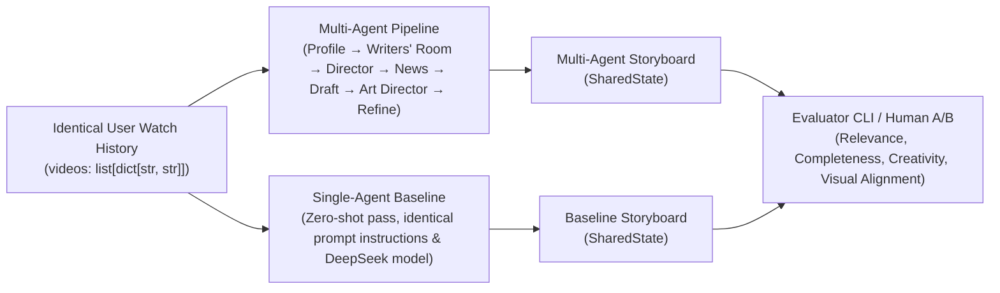

# GEMINI.md — Developer & AI Agent Operating Manual
**Project:** Multi-Agent Storyboarding for Personalized Short-Video Generation  
**Course:** COMP 4221: Intro to NLP (HKUST, Fall 2026)  
**Living Research Tracker:** [`docs/project_tracker.md`](docs/project_tracker.md)  
**Live Data Collection Tool:** [`https://charlesdupouy.github.io/nlp-multiagent-storyboarding/`](https://charlesdupouy.github.io/nlp-multiagent-storyboarding/)

This document provides guidance to Antigravity (and other AI agents or engineers) when working in this codebase. It explains the project's purpose, architecture, invariants, directory structure, and standard operating procedures.

---

## 1. Project Mission & Research Question

This capstone project investigates whether a **tool-augmented multi-agent pipeline with visual grounding** generates superior personalized 60-second video storyboards compared to a **neutral single-agent zero-shot LLM baseline**, starting from real YouTube Shorts watch histories.

### Core Research Claim
> *On **personalized short-video storyboarding**, our change — **a tool-augmented multi-agent brainstorming pipeline with visual grounding** — should improve **content creativity, visual coherence, and alignment with niche user interests** relative to **a single-agent zero-shot generation baseline**, measured by **LLM-as-a-judge relevance/creativity scores and blind human preference testing** under a budget of **$50 in API credits and local compute**.*

### Team Ownership & Deliverables
- **Charles Dupouy (Lead Architecture & Tools):** Multi-agent orchestrator, agent designs, tool integrations (`youtube_tool`, `news_tool`, `image_tool`), prompt engineering, baseline harmonization, and final paper synthesis.
- **Antoine Lepin (Data & Baseline Owner):** Peer watch history collection via GitHub Pages web tool, dataset curation/filtering, and running baseline batches.
- **Max Robertson (Evaluation & Demo Owner):** Automated LLM judge (`evaluation/evaluator.py`), human blind A/B evaluation, and video sketch renderer (TTS + images).

---

## 2. Essential Commands (Quick Reference)

Always activate the project virtual environment before running any commands:
```bash
source .venv/bin/activate
```

### Execution & Testing
```bash
# Run the multi-agent pipeline on an example history
python3 main.py --history data/user_histories/example.json

# Run the single-agent baseline on the exact same history
python3 main.py --history data/user_histories/example.json --baseline

# Run the full unit test suite (fast, offline)
python3 -m unittest discover tests

# Ingest an exported watch history from the web collector
python3 src/tools/import_user_history.py /path/to/exported.json participant_name
```

### Evaluation & Scoring
```bash
# Score a single storyboard using the LLM judge (4 criteria: 0.0 - 10.0 scale)
python3 evaluation/evaluator.py --storyboard outputs/storyboards/storyboard_xyz.json

# Perform side-by-side comparative scoring between Multi-Agent and Baseline storyboards
python3 evaluation/evaluator.py --compare outputs/storyboards/storyboard_ma.json outputs/storyboards/storyboard_base.json

# Run the batch blinded LLM judge over all generated storyboard pairs (with A/B order debiasing)
python3 evaluation/llm_judge.py --dry-run                      # mock test plumbing without API calls
python3 evaluation/llm_judge.py --preset deepseek --limit 5    # pilot run with DeepSeek
python3 evaluation/llm_judge.py --preset gpt4o                 # full benchmark with GPT-4o
```

### Video Sketch Rendering (TTS + Subtitles + Slideshow)
```bash
# Render a storyboard JSON into an MP4 video with burned-in subtitles and TTS audio
python3 storyboard_to_video.py outputs/storyboards/storyboard_xyz.json -o outputs/storyboard_xyz.mp4

# Render with specific language voice or keep temporary audio files
python3 storyboard_to_video.py outputs/storyboards/storyboard_xyz.json --lang fr --keep-temp
```

---

## 3. Where to Look for What (Codebase Directory Layout)

```
GroupProjetct/
├── GEMINI.md                    # This authoritative operating manual
├── AGENT.md                     # Legacy operating manual (kept for compatibility)
├── main.py                      # CLI entry point (--history, --baseline, --config)
├── storyboard_to_video.py       # Video sketch renderer (storyboard JSON -> MP4 with TTS & subtitles)
├── requirements.txt             # Python dependencies
├── configs/
│   └── config.yaml              # Default configuration (models, API URLs, parameters)
├── prompts/                     # Versioned plain-text prompt registry (*.txt)
│   ├── profiler_r1_macro.txt    # Phase 1A macro video selection
│   ├── profiler_r2_synthesis.txt# Phase 1B deep profiling with spoken transcripts
│   ├── writers_room.txt         # Phase 2 candidate pitch ideation (3 distinct concepts)
│   ├── director.txt             # Phase 3 pitch critique, selection & production notes
│   ├── news_targeted_research.txt # Phase 4 search query formulation for winning pitch
│   ├── scriptwriter_draft.txt   # Phase 5 initial narrative & scene drafting
│   ├── image_query.txt          # Phase 6 physical stock query generation
│   ├── art_director_selection.txt # Phase 6 candidate image semantic re-ranking
│   ├── scriptwriter_refine.txt  # Phase 7 visual grounding with symbolic image refs
│   ├── baseline.txt             # Single-agent zero-shot baseline prompt
│   └── judge.txt                # 4-dimensional evaluation rubric prompt
├── src/
│   ├── orchestrator.py          # Coordinates the 7-phase pipeline loop
│   ├── core/
│   │   ├── state.py             # Central blackboard (SharedState, UserProfile, Storyboard, etc.)
│   │   └── llm_client.py        # Centralized LLM client with global token & cost accounting
│   ├── agents/                  # Autonomous specialized agents
│   │   ├── base_agent.py        # Abstract base agent class
│   │   ├── profiler_agent.py    # Two-round profiler with transcript extraction
│   │   ├── pitch_agent.py       # Writers' Room producing 3 diverse story pitches
│   │   ├── director_agent.py    # Showrunner selecting winning pitch with production notes
│   │   ├── news_retriever_agent.py # Targeted news/fact retriever querying NewsAPI
│   │   ├── image_search_agent.py   # Art Director: query cleaner + 4-candidate re-ranker
│   │   └── scriptwriter_agent.py   # 2-pass writer: initial draft + visual grounding pass
│   └── tools/                   # External APIs and data helpers (with mock fallbacks)
│       ├── youtube_tool.py      # youtube-transcript-api and oEmbed metadata scraper
│       ├── news_tool.py         # NewsAPI.org client with query simplification
│       ├── image_tool.py        # Unsplash API client with cinematic query sanitizer
│       └── import_user_history.py # Ingestion helper for web collector exports
├── baseline/
│   └── single_agent_baseline.py # Fair, competitive zero-shot single-agent baseline
├── evaluation/
│   ├── evaluator.py             # Single/pairwise LLM-as-a-judge scoring CLI
│   └── llm_judge.py             # Automated batch judge with position debiasing & caching
├── tools/
│   └── history_collector/       # Client-side watch history collector (bookmarklet + HTML)
├── data/
│   └── user_histories/          # Anonymized watch histories (e.g., example.json, charles.json)
├── outputs/
│   ├── storyboards/             # Generated JSON and Markdown storyboards (.gitignore applied)
│   └── judge/                   # Batch judge benchmark results, CSV summaries & cache
├── tests/
│   └── test_pipeline.py         # Unit tests for state, tools, query cleaning & serialization
├── docs/
│   └── project_tracker.md       # Living paper trail: decisions, costs, failure cases, milestones
└── Assignment/                  # Course assignment brief (main.tex) and paper template
```

---

## 4. Pipeline Architecture (The 7-Phase Execution Loop)

The multi-agent pipeline operates as a sequential blackboard architecture coordinated by `Orchestrator`:

```mermaid
flowchart TD
    I["User Watch History\n(Titles + URLs)"] --> P1["Phase 1A: Profiler Round 1\nMacro scan across history; selects 3-4 target videos"]
    P1 --> T1["Tool: youtube_transcript_api\nExtracts spoken dialogue & oEmbed creator metadata"]
    T1 --> P2["Phase 1B: Profiler Round 2\nSynthesizes fine-grained profile with concrete spoken insights"]
    P2 --> WR["Phase 2: WritersRoomAgent\nBrainstorms 3 distinct candidate pitches matching user style"]
    WR --> DIR["Phase 3: DirectorAgent (Showrunner)\nCritiques all 3 pitches, selects winner & issues production notes"]
    DIR --> N["Phase 4: NewsRetrieverAgent (Targeted Research)\nFormulates search queries specific to the winning pitch via NewsAPI.org"]
    N --> S1["Phase 5: ScriptwriterAgent (Draft Pass)\nDrafts 60s storyboard executing winning pitch + director guidance"]
    S1 --> IMG["Phase 6: ImageSearchAgent (Art Director)\n1. Physical query sanitization (no cinematic fluff)\n2. Candidate retrieval (4 per scene via Unsplash API)\n3. Semantic re-ranking to select most representative photo"]
    IMG --> S2["Phase 7: ScriptwriterAgent (Refine Pass)\nGrounds scenes to visual assets using symbolic refs ('img1')"]
    S2 --> RES["Programmatic URL Resolution\nMaps 'image_ref' → validated Unsplash CDN URLs (zero hallucination)"]
    RES --> O["Storyboard JSON & Markdown\n(Pitches, Director Decision, Scenes, Subtitles, Narration, Image URLs)"]
```



### The Controlled Comparison (Multi-Agent vs. Baseline)


---

## 5. Non-Negotiable Invariants & Architectural Rules

Every AI agent or engineer editing this codebase **MUST strictly uphold the following 6 rules**:

### Rule 1: Unified I/O Contract
- `Orchestrator.run(videos)` and `SingleAgentBaseline.run(videos)` **must accept the exact same input**:
  `videos: list[dict[str, str]]` where each dict contains `{"title": str, "url": str}`.
- Both systems **must return an instance of `SharedState`** (`src/core/state.py`).
- Downstream tools (evaluators, renderers, exporters) consume `SharedState` uniformly. Never introduce breaking changes to `SharedState` without updating both pipeline and baseline serializers.

### Rule 2: Continuous Project Tracker Updates (Living Paper Trail)
Whenever you introduce an architectural change, prompt revision, new tool, or run an experiment, you **MUST update [`docs/project_tracker.md`](docs/project_tracker.md)**:
- **Design Decisions Log:** Record the decision, rationale ("Why"), and alternatives considered (directly populates the paper's *Methodology* section).
- **Cost & Compute Log:** Log the Run ID, model, token counts, and cost (feeds the *Reproducibility & Compute* statement).
- **Error & Failure Case Studies:** Document any failure mode encountered, why it occurred, and how it was mitigated (critical for the paper's required *Error Analysis* section).
- **Status & Milestones:** Check off completed items and update ownership.

*Why:* The COMP 4221 capstone report requires a 6–8 page conference-style paper (due Dec 4). Keeping `project_tracker.md` up-to-date ensures the paper is effectively pre-written.

### Rule 3: Zero URL Hallucination
- LLMs must **never** invent or output image URLs directly.
- The `ImageSearchAgent` indexes assets into `state.image_catalog` using symbolic keys (`img1`, `img2`, ...).
- The `ScriptwriterAgent` in Phase 7 references only symbolic keys (`"image_ref": "img1"`).
- Programmatic resolution (`ImageContext.get_url()`) binds the real, validated CDN URL to the scene.

### Rule 4: Stock Image Query Sanitization
- Stock photo APIs (Unsplash, Pexels) fail when queries contain cinematic jargon (e.g., `"split screen"`, `"macro lens"`, `"cinematic 8k"`, `"exploded view"`).
- Queries formulated by the LLM must be sanitized through `clean_stock_query()` (`src/tools/image_tool.py`) to keep only concrete physical nouns before querying the API.

### Rule 5: Plain-Text Prompt Registry
- All system prompts must reside in `prompts/*.txt`.
- Never hardcode multi-line prompt strings inside agent Python files.
- This maintains clean git diffs, enables prompt versioning, and satisfies the course requirement for a clean reproducibility package.

### Rule 6: Privacy & Secret Hygiene
- Never commit `.env` or personal watch history JSON files in `data/user_histories/` (only `example.json` is committed).
- API keys must be loaded exclusively via environment variables (`DEEPSEEK_API_KEY`, `NEWSAPI_KEY`, `UNSPLASH_ACCESS_KEY`).

---

## 6. Agent Developer Recipes & Workflows

### Recipe A: Modifying or Adding an Agent
1. **Define the Agent:** Create `src/agents/<name>_agent.py` inheriting from `BaseAgent` (`src/agents/base_agent.py`).
2. **Externalize Prompt:** Create `prompts/<name>.txt` containing the system prompt.
3. **Update State:** If the agent produces new structured data, add dataclasses to `src/core/state.py` and update `SharedState.to_dict()` and `from_dict()`.
4. **Sequence in Orchestrator:** Add the agent invocation step in `src/orchestrator.py:Orchestrator.run()`.
5. **Unit Tests:** Add a test case in `tests/test_pipeline.py`.
6. **Log in Tracker:** Add an entry to the Design Decisions table in `docs/project_tracker.md`.

### Recipe B: Updating Prompts
1. Open the relevant file in `prompts/`.
2. Keep instructions structured with clear role definition, JSON output schema, and negative constraints.
3. If modifying `baseline.txt`, ensure instructions remain neutral—never introduce artificial handicaps or comedic personas that would invalidate the scientific comparison.
4. Run `python3 -m unittest discover tests` and perform a test run with `main.py`.

### Recipe C: Working with Tools & External APIs
All tools in `src/tools/` must follow the **Graceful Degradation Pattern**:
- Check for required environment variables (`os.getenv(...)`).
- If missing or rate-limited, automatically fall back to realistic mock responses without crashing the pipeline.
- Implement sanitization on inputs (e.g., `clean_stock_query()` for image queries).

### Recipe D: Running an Evaluation Run & Logging Results
1. Run the pipeline:
   ```bash
   python3 main.py --history data/user_histories/example.json
   ```
2. Run the baseline on the same file:
   ```bash
   python3 main.py --history data/user_histories/example.json --baseline
   ```
3. Run the LLM judge comparison:
   ```bash
   python3 evaluation/evaluator.py --compare outputs/storyboards/storyboard_<MA_RUN_ID>.json outputs/storyboards/storyboard_<BASE_RUN_ID>.json
   ```
4. Copy the token counts, costs, and scores into the Cost Log and Results tables in `docs/project_tracker.md`.

### Recipe E: Documenting an Error or Failure Mode
When an experiment fails, produces hallucinations, or uncovers an edge case:
1. Do not simply patch it silently.
2. Open `docs/project_tracker.md` Section 6 (*Error & Failure Case Studies*).
3. Document:
   - **Case Study ID & Component:** (e.g., `CS-02: ImageSearchAgent`)
   - **Trigger / Symptom:** What happened (e.g., unrepresentative image returned for macro query).
   - **Root Cause Analysis:** Why it happened.
   - **Mitigation & Fix:** How the pipeline was modified to resolve it.
   - **Paper Section:** Where this will be featured in the final report's *Error Analysis*.

---

## 7. Environment Variables & Configuration

The application is configured via `configs/config.yaml` and environment variables in `.env`:

| Variable | Required | Description | Default / Fallback |
|---|---|---|---|
| `DEEPSEEK_API_KEY` | Recommended | API key for DeepSeek LLM (`deepseek-chat`) | OpenAI-compatible endpoint |
| `NEWSAPI_KEY` | Optional | API key for NewsAPI.org | Falls back to realistic mock news articles |
| `NEWS_API_PROVIDER` | Optional | Provider flag (`newsapi` or `mock`) | `mock` if key is unset |
| `UNSPLASH_ACCESS_KEY` | Optional | API key for Unsplash Image API | Falls back to thematic placeholder CDN images |
| `IMAGE_API_PROVIDER` | Optional | Provider flag (`unsplash` or `mock`) | `mock` if key is unset |

---

## 8. Current Milestones & Immediate Next Steps

| Milestone | Target Date | Status | Primary Owner |
|---|---|---|---|
| Project Proposal | Oct 9 | ✅ Submitted (100%) | All |
| Multi-Agent Pipeline (v3.0) | Oct 31 | ✅ Complete & Tested | Charles |
| Live API Integrations (News + Unsplash) | Oct 31 | ✅ Complete & Tested | Charles |
| Single-Agent Baseline Neutralization | Oct 31 | ✅ Complete & Tested | Antoine / Charles |
| Automated Evaluator CLI | Oct 31 | ✅ Complete & Tested | Max |
| Peer Watch History Collection (10–15 users) | Nov 15 | 🔲 In Progress | Antoine |
| Batch Evaluation & Human A/B Testing | Nov 20 | 🔲 In Progress | Max |
| Live Presentation & Demo | Nov 24–26 | 🔲 Upcoming | All |
| Final Paper & Code Submission (6–8 pages) | Dec 4 | 🔲 Living tracker active | All (Charles lead) |
