# Multi-Agent Storyboarding for Personalized Short-Video Generation
**COMP 4221: Intro to NLP — Fall 2026**  
Team: Antoine Lepin · Max Robertson · Charles Dupouy  
Live Participant Collector: [https://charlesdupouy.github.io/nlp-multiagent-storyboarding/](https://charlesdupouy.github.io/nlp-multiagent-storyboarding/)

---

## Quick Start

```bash
# 1. Clone & install dependencies
pip install -r requirements.txt

# 2. Set your API credentials in .env
# (DEEPSEEK_API_KEY, NEWSAPI_KEY, UNSPLASH_ACCESS_KEY)

# 3. Run the full multi-agent pipeline (v3.2)
python3 main.py --history data/user_histories/example.json

# 4. Run the single-agent baseline
python3 main.py --history data/user_histories/example.json --baseline

# 5. Run LLM-as-a-Judge evaluation / comparison
python3 evaluation/evaluator.py --compare outputs/storyboards/storyboard_ma.json outputs/storyboards/storyboard_base.json

# 6. Run unit tests
python3 -m unittest discover tests/
```

---

## System Architecture (v3.2)

```mermaid
flowchart TD
    I["User Watch History\n(Titles + URLs)"] --> P1["Phase 1A: Profiler Round 1\nMacro scan & active candidate video selection"]
    P1 --> T1["Tool: youtube_transcript_api\nExtracts actual spoken dialogue & oEmbed creator metadata"]
    T1 --> P2["Phase 1B: Profiler Round 2\nSynthesizes fine-grained profile with concrete spoken insights"]
    P2 --> WR["Phase 2: WritersRoomAgent\nBrainstorms 3 distinct candidate pitches matching user style"]
    WR --> DIR["Phase 3: DirectorAgent (Showrunner)\nCritiques all 3 pitches, selects winner & issues production notes"]
    DIR --> N["Phase 4: NewsRetrieverAgent (Targeted Research)\nFormulates search queries specific to the winning pitch via NewsAPI.org"]
    N --> S1["Phase 5: ScriptwriterAgent (Draft Pass)\nDrafts 60s storyboard executing winning pitch + director guidance"]
    S1 --> IMG["Phase 6: ImageSearchAgent (Art Director)\n1. Physical query sanitization (no cinematic fluff)\n2. Candidate retrieval (4 per scene via Unsplash API)\n3. Semantic re-ranking to select most representative photo"]
    IMG --> S2["Phase 7: ScriptwriterAgent (Refine Pass)\nGrounds scenes to visual assets using symbolic refs ('img1')"]
    S2 --> RES["Programmatic URL Resolution\nMaps 'image_ref' → validated Unsplash CDN URLs (no hallucination)"]
    RES --> O["Storyboard JSON & Markdown\n(Pitches, Director Decision, Scenes, Subtitles, Narration, Image URLs)"]
```



---

## Collecting Real User Histories for Evaluation

To collect watch histories from study participants without API keys or credentials:
1. Share the live GitHub Pages link: [https://charlesdupouy.github.io/nlp-multiagent-storyboarding/](https://charlesdupouy.github.io/nlp-multiagent-storyboarding/)
2. The participant drags the **📌 Export Shorts History** bookmarklet to their browser bar.
3. They visit [youtube.com/feed/history](https://www.youtube.com/feed/history), click the bookmark, and download `youtube_shorts_history.json`.
4. Ingest their exported file into the pipeline:
   ```bash
   python3 src/tools/import_user_history.py /path/to/downloaded.json participant_alice
   ```
5. Run the storyboarding generator:
   ```bash
   python3 main.py --history data/user_histories/participant_alice.json
   ```

---

## Project Structure

```
.
├── main.py                        # Top-level CLI (pipeline & baseline execution)
├── GEMINI.md                      # Machine & agent onboarding specification
├── configs/config.yaml            # Model and API configuration
├── src/
│   ├── orchestrator.py            # 7-phase pipeline controller
│   ├── core/
│   │   ├── state.py               # SharedState blackboard (pitches, director notes, token audit)
│   │   └── llm_client.py          # OpenAI-compatible LLM wrapper + token/cost accounting
│   ├── agents/
│   │   ├── base_agent.py          # Abstract base class for all agents
│   │   ├── profiler_agent.py      # Two-round profiler with transcript extraction
│   │   ├── pitch_agent.py         # Writers' room ideation (3 distinct candidate pitches)
│   │   ├── director_agent.py      # Showrunner critique & pitch commissioning
│   │   ├── news_retriever_agent.py # Targeted news/fact research on winning pitch
│   │   ├── image_search_agent.py  # Art Director image curation & candidate selection
│   │   └── scriptwriter_agent.py  # 2-pass drafting & visual grounding
│   └── tools/
│       ├── youtube_tool.py        # YouTube spoken transcript & oEmbed metadata extraction
│       ├── news_tool.py           # NewsAPI.org search with query simplification
│       ├── image_tool.py          # Unsplash API search with query sanitization
│       └── import_user_history.py # CLI ingestion & title enrichment helper
├── baseline/
│   └── single_agent_baseline.py  # Scientifically neutral single-agent baseline
├── evaluation/
│   └── evaluator.py              # LLM-as-a-judge rubric scoring & comparison CLI
├── data/
│   └── user_histories/           # User watch histories (JSON)
├── outputs/storyboards/          # Generated storyboard JSON and companion Markdown files
├── prompts/                      # Registry of versioned system prompts (.txt)
├── tests/                        # Unit tests (run with python3 -m unittest discover tests)
└── docs/                         # Project tracker, dev log & GitHub Pages assets
```

---

## Environment Variables

| Variable | Description |
|---|---|
| `DEEPSEEK_API_KEY` | DeepSeek API key (required) |
| `LLM_BASE_URL` | LLM API base URL (default: `https://api.deepseek.com`) |
| `NEWSAPI_KEY` | NewsAPI.org key (live news search) |
| `UNSPLASH_ACCESS_KEY` | Unsplash API key (live photographic search) |
