# Multi-Agent Storyboarding for Personalized Short-Video Generation
**COMP 4221: Intro to NLP — Fall 2026**  
Team: Antoine Lepin · Max Robertson · Charles Dupouy  
Live Participant Collector: [https://charlesdupouy.github.io/nlp-multiagent-storyboarding/](https://charlesdupouy.github.io/nlp-multiagent-storyboarding/)

---

## Quick Start

```bash
# 1. Clone & install dependencies
pip install -r requirements.txt

# 2. Set your API credentials in .env
# (DEEPSEEK_API_KEY, optional: NEWSAPI_KEY, UNSPLASH_ACCESS_KEY)

# 3. Run the full multi-agent pipeline (v4.0)
python3 main.py --history data/user_histories/example.json

# 4. Run the single-agent baseline on the exact same history
python3 main.py --history data/user_histories/example.json --baseline

# 5. Render a storyboard JSON into a video sketch (TTS + subtitles + slideshow MP4)
python3 storyboard_to_video.py outputs/<user>/agentic/agentic_storyboard_<user>_<datetime>.json

# 6. Run LLM-as-a-Judge comparison (side-by-side with position debiasing)
python3 evaluation/llm_judge.py --compare outputs/<user>/agentic/agentic_storyboard_<user>_<datetime>.json outputs/<user>/baseline/baseline_storyboard_<user>_<datetime>.json

# Or run batch automated evaluation across all history pairs
python3 evaluation/llm_judge.py --preset deepseek

# 7. Run unit tests
python3 -m unittest discover tests/
```

---

## System Architecture (v4.0)

```mermaid
flowchart TD
    I["User Watch History\n(Titles + URLs)"] --> P1["Phase 1A: Profiler Round 1\nMacro scan & active candidate video selection"]
    P1 --> T1["Tool: youtube_transcript_api\nExtracts actual spoken dialogue & oEmbed creator metadata"]
    T1 --> P2["Phase 1B: Profiler Round 2\nSynthesizes fine-grained profile with concrete spoken insights"]
    P2 --> WR["Phase 2: WritersRoomAgent\nBrainstorms 3 distinct candidate pitches matching user style"]
    WR --> DIR["Phase 3: DirectorAgent (Showrunner)\nCritiques all 3 pitches, selects winner & issues production notes"]
    DIR --> K["Phase 4: KnowledgeRetrieverAgent (Targeted Research)\nMulti-tiered queries (Wikipedia + NewsAPI + LLM synthesis)"]
    K --> S1["Phase 5: ScriptwriterAgent (Draft Pass)\nDrafts 60s storyboard executing winning pitch + director guidance"]
    S1 --> ART["Phase 6: ArtDirectorAgent\n1. Physical query sanitization (no cinematography fluff)\n2. Candidate retrieval (4 per scene via Unsplash API)\n3. Semantic re-ranking to select most representative photo"]
    ART --> S2["Phase 7: ScriptwriterAgent (Refine Pass)\nGrounds scenes to visual assets using symbolic refs ('img1')"]
    S2 --> RES["Programmatic URL Resolution\nMaps 'image_ref' → validated Unsplash CDN URLs (no hallucination)"]
    RES --> O["Storyboard JSON & Markdown\n(Pitches, Director Decision, Scenes, Subtitles, Narration, Image URLs)"]
```



---

## Collecting Real User Histories for Evaluation

To collect watch histories from study participants without API keys or credentials:
1. Share the live GitHub Pages link: [https://charlesdupouy.github.io/nlp-multiagent-storyboarding/](https://charlesdupouy.github.io/nlp-multiagent-storyboarding/)
2. The participant drags the **📌 Export Shorts History** bookmarklet to their browser bar.
3. They visit [youtube.com/feed/history](https://www.youtube.com/feed/history), click the bookmark, and download `youtube_shorts_history.json`.
4. Ingest their exported file into the pipeline (and optionally randomly partition it into $X$ parts for multi-video evaluation):
   ```bash
   # Standard ingestion:
   python3 src/tools/import_user_history.py --input /path/to/downloaded.json --user participant_alice

   # Or ingest and randomly split into 3 parts (3 distinct video pairs per user):
   python3 src/tools/import_user_history.py --input /path/to/downloaded.json --user participant_alice --split 3
   ```
5. Run the storyboarding generator:
   ```bash
   # Multi-agent
   python3 main.py --history data/user_histories/participant_alice.json

   # Baseline
   python3 main.py --history data/user_histories/participant_alice.json --baseline
   ```

---

## Project Structure

```
.
├── main.py                        # Top-level CLI (pipeline & baseline execution)
├── storyboard_to_video.py         # Video sketch renderer (JSON -> MP4 with TTS & subtitles)
├── GEMINI.md                      # Machine & agent onboarding specification
├── configs/config.yaml            # Model and API configuration
├── src/
│   ├── orchestrator.py            # 7-phase pipeline controller
│   ├── core/
│   │   ├── state.py               # SharedState blackboard (pitches, director notes, token audit)
│   │   └── llm_client.py          # Centralized LLM wrapper + token/cost accounting
│   ├── agents/
│   │   ├── base_agent.py          # Abstract base class for all agents
│   │   ├── profiler_agent.py      # Phase 1: Two-round profiler with transcript extraction
│   │   ├── writers_room_agent.py  # Phase 2: Writers' room producing 3 distinct candidate pitches
│   │   ├── director_agent.py      # Phase 3: Showrunner critique & pitch selection
│   │   ├── knowledge_retriever_agent.py # Phase 4: Targeted fact, lore & news research
│   │   ├── scriptwriter_agent.py  # Phase 5 & 7: 2-pass drafting & visual grounding
│   │   └── art_director_agent.py  # Phase 6: Art Director image query cleaner & re-ranker
│   └── tools/
│       ├── youtube_tool.py        # YouTube spoken transcript & oEmbed metadata extraction
│       ├── knowledge_tool.py      # Multi-tier knowledge search (Wikipedia + NewsAPI + LLM synthesis)
│       ├── news_tool.py           # Backward-compatibility wrapper for knowledge_tool
│       ├── image_tool.py          # Unsplash API search with query sanitization
│       └── import_user_history.py # CLI ingestion, title enrichment & random split helper
├── baseline/
│   └── single_agent_baseline.py   # Scientifically neutral single-agent baseline (with naive Top-1 image search)
├── evaluation/
│   └── llm_judge.py               # Batch & pairwise LLM judge with position debiasing (grades on 5 + win rates)
├── data/
│   └── user_histories/            # User watch histories (JSON)
├── outputs/
│   ├── <user>/                    # Per-user subdirectories (e.g. example, charles)
│   │   ├── agentic/               # Agentic storyboards (JSON+MD) and rendered videos (MP4)
│   │   ├── baseline/              # Baseline storyboards (JSON+MD) and rendered videos (MP4)
│   │   └── judge/                 # Per-user LLM judge evaluations and comparisons
│   └── judge/                     # Batch evaluation results, summary reports & CSV exports
├── prompts/                       # Plain-text registry of versioned system prompts (.txt)
├── tests/                         # Unit tests (run with python3 -m unittest discover tests)
└── docs/                          # Living project tracker, dev log & GitHub Pages assets
```

---

## Environment Variables

| Variable | Required | Description | Fallback |
|---|---|---|---|
| `DEEPSEEK_API_KEY` | Recommended | DeepSeek API key for LLM agents | OpenAI-compatible endpoint |
| `NEWSAPI_KEY` | Optional | NewsAPI.org key for breaking news search | Falls back to Wikipedia / LLM synthesis |
| `UNSPLASH_ACCESS_KEY` | Optional | Unsplash API key for stock photo search | Falls back to thematic placeholder CDN assets |
