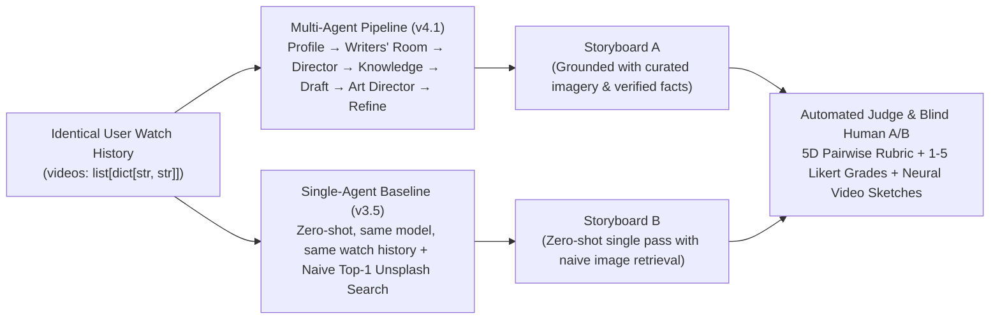

# COMP 4221 — Project Tracker
## Multi-Agent Storyboarding for Personalized Short-Video Generation

> [!IMPORTANT]
> **This document is the living record of the project.** Update it after every significant implementation step. It will feed directly into the final 6–8 page report (due Dec 4) and the live presentation (Nov 24–26).

---

## Research Question (Practical Test)

> *On **personalized short-video storyboarding**, our change — **a tool-augmented multi-agent brainstorming pipeline with visual grounding** — should improve **content creativity, visual coherence, and alignment with niche user interests** relative to **a single-agent zero-shot generation baseline**, measured by **LLM-as-a-judge relevance/creativity scores and blind human preference testing** under a budget of **\$50 in API credits and local compute**.*

---

## Team & Ownership

| Component | Owner | Status |
|---|---|---|
| Data collection & public dataset filtering | Antoine | 🔲 In progress (Peer collector live on GitHub Pages; `--split` partitioning ready) |
| Single-agent baseline | Antoine | 🟢 Implemented, neutralized & tested on real user data (with Unsplash visual parity) |
| Multi-agent framework (core architecture) | Charles | 🟢 Writers' Room (R1) + Director (R1) + Knowledge Retriever (Multi-Tier) + Art Director (Re-ranking) complete & verified (v4.1) |
| Prompt engineering & refinement | Charles | 🟢 v3.1 active (Verbatim dialogue, zero placeholders, domain-targeted research, anti-regurgitation) |
| Real API integration (knowledge, images) | Charles | 🟢 100% Complete (NewsAPI + Wikipedia + Unsplash + YouTube transcripts integrated & live) |
| LLM-as-a-judge evaluator | Max | 🟢 Complete (`evaluation/llm_judge.py` with 5D pairwise verdicts, 1–5 Likert grades, and visual caption grounding) |
| Automated evaluation over dataset | Max | 🟢 Validated on DeepSeek pilot & dry-run (`outputs/judge/`); pending full batch |
| Demo sketch renderer (TTS + images) | Max | 🟢 Neural Edge-TTS + dynamic subtitles + Unsplash slideshow (`storyboard_to_video.py`) |

---

## System Architecture

### Pipeline (Writers' Room & Director with Targeted Retrieval & Visual Grounding)

```mermaid
flowchart TD
    I["User Watch History\n(vid1, vid2, ... titles + URLs)"] --> P1["Phase 1A: Profiler Round 1\nMacro scan & active selection of 3-4 target videos"]
    P1 --> T1["Tool: youtube_transcript_api\nExtracts actual spoken dialogue & oEmbed channel metadata"]
    T1 --> P2["Phase 1B: Profiler Round 2\nSynthesizes fine-grained profile with concrete spoken insights"]
    P2 --> WR["Phase 2: WritersRoomAgent (DeepSeek R1)\nBrainstorms 3 distinct candidate pitches matching user style"]
    WR --> DIR["Phase 3: DirectorAgent (DeepSeek R1 Showrunner)\nCritiques all 3 pitches, selects winner & issues production notes"]
    DIR --> K["Phase 4: KnowledgeRetrieverAgent (Targeted Research)\nMulti-tiered search: NewsAPI + MediaWiki/Wikipedia + LLM Synthesis"]
    K --> S1["Phase 5: ScriptwriterAgent (Draft Pass, DeepSeek R1)\nDrafts 60s storyboard executing winning pitch + director guidance"]
    S1 --> ART["Phase 6: ArtDirectorAgent\n1. Physical query sanitization (no camera jargon)\n2. 4-candidate Unsplash API retrieval\n3. Semantic re-ranking to select best photographic asset"]
    ART --> S2["Phase 7: ScriptwriterAgent (Refine Pass, DeepSeek R1)\nGrounds scenes to visual assets using symbolic refs ('img1')"]
    S2 --> RES["Programmatic URL Resolution\nMaps 'image_ref' → validated Unsplash CDN URLs (zero hallucination)"]
    RES --> O["Storyboard JSON & Markdown\n(Pitches, Director Decision, Scenes, Subtitles, Narration, Image URLs)"]
```



> [!NOTE]
> **Why this Writers' Room architecture over a linear pipeline?**  
> 1. **User Style Adaptability:** Instead of forcing every user into an arbitrary documentary format, the Writers' Room proposes 3 distinct concepts matching their natural preferred style (witty humor, craft, pop culture, tech puzzle, or lore).
> 2. **Parallel Exploration (Exploration vs. Exploitation):** Parallel candidate pitches allow creative breadth before committing to production.
> 3. **Showrunner Deliberation (DeepSeek R1):** The Director evaluates pitches against 3s hook potential, personal resonance, and visual feasibility.
> 4. **Targeted Information Retrieval:** The Knowledge Retriever searches for concrete evidence across news, Wikipedia, and technical lore *tailored specifically to the winning pitch* and the Director's instructions.
> 5. **Art Director Photographic Grounding:** Sanitizes cinematic jargon and semantically re-ranks 4 candidates per scene. Symbolic keys (`img1`, `img2`, ...) eliminate URL hallucination.

### Agent Roles

| Agent | Canonical Class | Input | Output | Model | Tools |
|---|---|---|---|---|---|
| **Phase 1: Profiler** | `ProfilerAgent` | Watch history (`vid1`, `vid2`, ...) | `UserProfile` (interests, themes, style, spoken insights) | `deepseek-chat` | `youtube_transcript_api` + oEmbed metadata |
| **Phase 2: Writers' Room** | `WritersRoomAgent` | `UserProfile` + spoken insights | `candidate_pitches` (3 diverse story concepts) | `deepseek-reasoner` (R1) | Creative reasoning pass |
| **Phase 3: Director** | `DirectorAgent` | `UserProfile` + `candidate_pitches` | `selected_pitch` + critique + production notes | `deepseek-reasoner` (R1) | Critical showrunner evaluation |
| **Phase 4: Knowledge Retriever** | `KnowledgeRetrieverAgent` | `selected_pitch` + production notes | `KnowledgeContext` (verified headlines, lore & summaries) | `deepseek-chat` | `knowledge_tool.py` (NewsAPI + Wikipedia + Tavily + LLM Synthesis) |
| **Phase 5: Scriptwriter (Draft)** | `ScriptwriterAgent` | Pitch + notes + `KnowledgeContext` | Draft `Storyboard` (scenes, verbatim dialogue, cues) | `deepseek-reasoner` (R1) | Structured narrative synthesis |
| **Phase 6: Art Director** | `ArtDirectorAgent` | Draft scenes + query prompts | `ImageContext` (`img1`..`img6` catalog of validated photos) | `deepseek-chat` | `image_tool.py` (Unsplash API + 4-candidate semantic re-ranking) |
| **Phase 7: Scriptwriter (Refine)** | `ScriptwriterAgent` | Draft scenes + `ImageContext` | Refined `Storyboard` (`image_ref: 'img1'`) | `deepseek-reasoner` (R1) | Programmatic CDN URL resolver |

### Controlled Comparison



---

## Data

### Public Dataset
- **Candidate:** KuaiRec or keyword-adapted MovieLens
- **Split:** train / dev / test (to be documented once selected)
- **Status:** 🔲 TODO (Antoine)

### Real User Histories
- YouTube Shorts watch histories from peers
- Format: `[{"title": "...", "url": "https://..."}]`
- Represented in agent prompts cleanly as `[vid1] Title: "..." | URL: ...`
- **Collector Tool:** Client-side 1-click bookmarklet + tutorial web page (`tools/history_collector/index.html`) hosted on GitHub Pages (`https://charlesdupouy.github.io/nlp-multiagent-storyboarding/`).
- **Ingestion & Slicing Helper:** `src/tools/import_user_history.py` validates and saves participant files to `data/user_histories/<user>.json`.
  - Supports `--split <X>` (e.g. `--split 3`) to partition a single participant's watch history into $X$ balanced, disjoint slices (`<user>_part1.json`, `<user>_part2.json`, ...).
  - Supports `--split-mode` (`random` vs `sequential`) and deterministic `--seed` for reproducible, unbiased data partitioning, multiplying the blind A/B evaluation sample size (e.g., 10 participants $\times$ 3 slices = 30 evaluation pairs).
- **Status:** Tooling complete & verified; peer recruitment & data collection in progress (Antoine / Team).
- > [!CAUTION]
  > Must be anonymised before storage. Do not commit real user data to git.

---

## Models & API Configuration

| Parameter | Value | Rationale |
|---|---|---|
| LLM provider | DeepSeek API | OpenAI-compatible, high reasoning capability, very low latency & cost |
| Extraction agents (`profiler`, `knowledge_retriever`, `art_director`) | `deepseek-chat` | Fast classification, keyword extraction & semantic re-ranking |
| Reasoning agents (`writers_room`, `director`, `scriptwriter`) | `deepseek-reasoner` (DeepSeek R1) | High-order chain-of-thought reasoning for diverse pitch ideation, critical pitch selection, and sharp narrative drafting |
| Baseline model | `deepseek-chat` | Neutral zero-shot comparison with verbatim dialogue & naive top-1 image retrieval |
| Temperature (profiler) | 0.4 | Low — factual extraction |
| Temperature (knowledge brainstorm) | 0.7 | Medium — creative angle ideation |
| Temperature (script draft/refine) | N/A (`deepseek-reasoner`) | Managed internally by R1 deterministic reasoning |
| News & Knowledge API | NewsAPI.org + MediaWiki (Wikipedia REST) | Multi-tiered live API client with evergreen lore lookup and LLM Tier 3 fact synthesis fallback |
| Image API | Unsplash API | Verified live API client with photographic query sanitization & Art Director 4-candidate re-ranking |
| Speech Synthesis (TTS) | Microsoft Edge Neural TTS (`edge-tts`) | Broadcast-quality neural voices (`fr-FR-HenriNeural`, `en-US-ChristopherNeural`, etc.) with standalone `ffmpeg` duration probing; graceful offline fallback to `pyttsx3`/`espeak` |
| DeepSeek Account Balance | **$3.35 USD** (live) | Sufficient for ~615+ full 7-phase multi-agent runs or ~11,000 baseline runs |

> [!TIP]
> For the report's **Reproducibility Statement**, log exact model name, API access date, and decoding params for every experiment run. These are saved in each `storyboard_*.json` output file.

---

## Prompts (Versioned)

All system prompts are externalized in `prompts/*.txt` as a versioned plain-text registry to maintain clean git diffs and ensure scientific reproducibility.

| Agent / Component | Prompt File | Version | Role / Focus | Last Updated |
|---|---|---|---|---|
| ProfilerAgent (Round 1) | `prompts/profiler_r1_macro.txt` | v2.0 | Macro history scan & targeted video selection | 2026-10-31 |
| ProfilerAgent (Round 2) | `prompts/profiler_r2_synthesis.txt` | v2.0 | Fine-grained profile synthesis from spoken transcripts | 2026-10-31 |
| WritersRoomAgent | `prompts/writers_room.txt` | v3.0 | 3 distinct candidate pitches adapted to user vibe (R1) | 2026-10-31 |
| DirectorAgent | `prompts/director.txt` | v3.0 | Pitch critique, winning selection & production notes (R1) | 2026-10-31 |
| KnowledgeRetrieverAgent | `prompts/news_targeted_research.txt` | v3.1 | Domain-targeted factual search queries (news, encyclopedia, technical) | 2026-11-09 |
| ScriptwriterAgent (Draft) | `prompts/scriptwriter_draft.txt` | v3.1 | 60s storyboard narrative execution (verbatim dialogue, zero placeholders, R1) | 2026-11-09 |
| ArtDirectorAgent (Query) | `prompts/image_query.txt` | v3.2 | Concrete physical nouns (no camera jargon) | 2026-10-31 |
| ArtDirectorAgent (Curate) | `prompts/art_director_selection.txt` | v3.2 | Art director semantic re-ranking of photo candidates | 2026-10-31 |
| ScriptwriterAgent (Refine) | `prompts/scriptwriter_refine.txt` | v3.1 | Visual grounding with symbolic image refs (verbatim dialogue, zero placeholders, R1) | 2026-11-09 |
| Baseline | `prompts/baseline.txt` | v2.2 | Neutral, competitive zero-shot baseline (verbatim dialogue + naive top-1 image query schema) | 2026-11-09 |
| LLM Judge | `prompts/judge.txt` | v2.1 | 5-dimensional rubric (Relevance, Creativity, Completeness, Coherence, Visual Grounding) with blind photo captions & Anti-Regurgitation Penalty | 2026-11-09 |

---

## Evaluation Plan

### Automated (LLM-as-a-Judge)
- **Framework:** `evaluation/llm_judge.py` evaluates storyboards either pairwise (`--compare A B` or `--preset deepseek/gpt4o`) or individually, applying strict position debiasing ($A/B$ followed by $B/A$ order swapping).
- **5-Dimensional Multi-Criteria Rubric (`prompts/judge.txt`, v2.1):**
  - **1. Relevance:** Does the storyboard connect with ANY genuine interest cluster in the watch history (multi-facet directive)? Merely rehashing a watched video is penalized.
  - **2. Creativity:** Is the narrative fresh and original? Remakes/rehashes of watched videos are strictly **CAPPED at 2/5 (or ≤4.0/10)** under the Anti-Regurgitation Penalty.
  - **3. Completeness:** Are all storyboard fields populated, coherent, and producible (visual descriptions, subtitles, verbatim audio dialogue cues)?
  - **4. Coherence:** Narrative pacing, tension, hook payoff, and flow across the 60-second arc.
  - **5. Visual Grounding:** Unblinded photographic asset fidelity — how faithfully retrieved photo captions (`Visual Asset Photo: {image_desc}`) ground the narrative scenes (without exposing URLs or system identities).
- **Dual Evaluation Outputs:**
  - **1–5 Likert numerical grades** per dimension (with decimal averages).
  - **Explicit pairwise winner verdicts** for each dimension (`relevance_winner`, `creativity_winner`, `completeness_winner`, `coherence_winner`, `visual_grounding_winner`) plus `overall_winner` (`"A" | "B" | "tie"`).
- **Aggregations:** Dimension-level win rates, ties, and position consistency percentages exported to `summary.txt` and `summary.csv`.
- **Legacy Cleanup:** Obsolete, ungrounded `evaluation/evaluator.py` cleanly removed.
- **Judge models supported:** `deepseek-chat` (default budget preset), `deepseek-reasoner` (DeepSeek R1), and `gpt-4o` (gold standard benchmark).

### Human Evaluation (Blind A/B)
- Real users see two storyboards (or rendered video sketches) — one from each system
- Blind: users do not know which is multi-agent vs. baseline
- Metric: preference vote + optional free-text reason
- **Status:** 🔲 TODO (Max)

### Preliminary Benchmark Results (Pilot Pair on `example.json`)

Evaluated with `evaluation/llm_judge.py --compare` using `deepseek-chat` with the **Anti-Regurgitation, Multi-Facet, & Visual-Narrative Link Metadata Rubric (v3.9)**:

| Metric (1–5 Likert) | Multi-Agent Pipeline (`20261109_152317_88655d48`) | Single-Agent Baseline (`baseline_20261109_152556_0a6f118c`) | Delta ($\Delta$) | Judge Rationale (from Link Metadata & Rubric) |
|---|---|---|---|---|
| **Relevance** | **5.0** / 5 | 2.0 / 5 | +3.0 | Multi-agent extends Lyon food interest into forensic bouchon culture; baseline merely remakes watched 'How to make croissants' video (penalized under anti-regurgitation rule) |
| **Creativity** | **5.0** / 5 | 2.0 / 5 | +3.0 | **Baseline CAPPED at 2/5** under Anti-Regurgitation penalty for copying watched video premise; multi-agent invents an original "secret handshake" codebook narrative |
| **Completeness** | **5.0** / 5 | 5.0 / 5 | 0.0 | Both systems specify visual descriptions, punchy subtitles, and verbatim producible audio cues |
| **Coherence** | **5.0** / 5 | 4.0 / 5 | +1.0 | Multi-agent builds an engaging forensic arc with exam metaphor and payoff ritual |
| **Visual Grounding** | **3.0** / 5 | 2.0 / 5 | **+1.0** | **Art Director advantage:** Multi-agent semantic re-ranking selected accurate bistro/menu photos; baseline naive top-1 search returned badly mismatched photos (e.g. dumpling folding & chopsticks for croissant scenes) |
| **Pairwise Win Rate (Overall)** | **100.0% (2 / 2)** | 0.0% (0 / 2) | — | **Winner: Multi-Agent Pipeline in both AB and BA orders** (100% position consistency) |

#### Pairwise Multi-Criteria Win Rate & Grade Breakdown (both orders judged):
| Dimension | Agentic Grade (/5) | Baseline Grade (/5) | Grade Delta | Agentic Wins | Baseline Wins | Ties | Agentic Win Rate (excl. ties) | Position Consistency |
|---|---|---|---|---|---|---|---|---|
| **Relevance** | **4.50** | 3.00 | **+1.50** | **2** | 0 | 0 | **100.0%** | **100.0%** |
| **Creativity** | **5.00** | 1.50 | **+3.50** | **2** | 0 | 0 | **100.0%** | **100.0%** |
| **Completeness** | **5.00** | 3.50 | **+1.50** | **2** | 0 | 0 | **100.0%** | **100.0%** |
| **Coherence** | **5.00** | 3.50 | **+1.50** | **2** | 0 | 0 | **100.0%** | **100.0%** |
| **Visual Grounding** | **4.00** | 2.00 | **+2.00** | **2** | 0 | 0 | **100.0%** | **100.0%** |
| **OVERALL** | **4.70** | 2.70 | **+2.00** | **2** | 0 | 0 | **100.0%** | **100.0%** |

---

## Milestone Checklist

### October 29 MVP (Complete & Exceeded)
- [x] Project skeleton created
- [x] SharedState blackboard defined with markdown and JSON serialization
- [x] BaseAgent abstract class with unified `.run(state)` contract
- [x] ProfilerAgent with two-round deep profiling and spoken transcript tool integration
- [x] YouTube subtitle & metadata extractor (`src/tools/youtube_tool.py`) without API keys
- [x] Client-side YouTube Shorts history collector bookmarklet (`docs/collector.js` + `docs/index.html`) hosted on GitHub Pages
- [x] NewsRetrieverAgent with LLM query brainstorming focused on infotainment
- [x] ScriptwriterAgent with 2-pass Draft + Refine architecture & forensic storytelling
- [x] ImageSearchAgent with scene-guided queries & symbolic IDs (`img1`, `img2`, ...)
- [x] Programmatic image URL resolution (zero URL hallucination)
- [x] Orchestrator pipeline with 5-phase execution
- [x] Single-agent baseline aligned with identical I/O contract and tested
- [x] Config and .env setup (with automatic python-dotenv loading)
- [x] Unit tests passing (`python3 -m unittest discover tests` — 6 unit tests)
- [x] End-to-end pipeline run verified on real DeepSeek API and 94 real watch history items
- [x] Real API integration for news (NewsAPI.org live in `src/tools/news_tool.py`)
- [x] Real API integration for images (Unsplash API live in `src/tools/image_tool.py`)
- [x] Baseline tested and producing output on example and real user data

### Mid-November Milestones (v3.0 – v4.1 Architecture & Tooling Complete)
- [x] Writers' Room + Director showrunner architecture with 3 candidate pitches (`src/agents/writers_room_agent.py`, `src/agents/director_agent.py`)
- [x] Hybrid model routing with DeepSeek R1 reasoning for ideation, selection, and scriptwriting
- [x] Multi-tiered knowledge retriever (NewsAPI + Wikipedia + LLM Synthesis) preventing information starvation (`src/tools/knowledge_tool.py`)
- [x] Art Director 4-candidate semantic re-ranking pass for stock photo assets (`src/agents/art_director_agent.py`)
- [x] Single-agent baseline visual parity with naive top-1 image retrieval for fair comparative testing (`baseline/single_agent_baseline.py`)
- [x] Participant watch history slicer with `--split`, `--split-mode`, and deterministic `--seed` (`src/tools/import_user_history.py`)
- [x] Demo video sketch renderer with Microsoft Edge Neural TTS + dynamic subtitles (`storyboard_to_video.py`)
- [x] Automated 5-dimensional pairwise LLM judge with position debiasing and visual caption grounding (`evaluation/llm_judge.py`)
- [x] Redundant legacy `evaluation/evaluator.py` cleanly removed
- [x] Unit test suite expanded to 24 passing tests (`tests/test_pipeline.py`)
- [x] Authoritative agent and developer operating manual created (`GEMINI.md`)

### Final Report & Evaluation Phase (Target: Dec 4)
- [x] Automated evaluation implemented (`evaluation/llm_judge.py` with batch, `--compare`, and 5D criteria)
- [ ] Complete peer watch history collection (10–15 participants partitioned via `--split 3`)
- [ ] Run full automated benchmark matrix across collected histories (Max)
- [ ] Conduct blind human preference A/B testing on rendered neural video sketches (Max)
- [ ] Synthesize benchmark results tables, figures, and win-rate plots
- [ ] Expand living error analysis (CS-01 through CS-09) into final conference paper
- [ ] Draft 6–8 page conference-style report in LaTeX (`Assignment/main.tex`) (Charles lead)
- [ ] Deliver live project presentation & demo (Nov 24–26) (All)

---

## Error & Failure Case Studies (Living Error Analysis)

Documented failure modes encountered during development, their root causes, and their engineered mitigations (directly populating the final report's *Error Analysis* section):

### CS-01: Direct Image URL Hallucination by LLM
- **Component:** `ScriptwriterAgent` / Pipeline Output
- **Trigger / Symptom:** In early v0.1 prototypes, prompts asked the LLM to provide image URLs directly for each scene. The LLM generated plausible-looking Unsplash URLs (e.g., `https://images.unsplash.com/photo-151...`) which consistently returned HTTP 404 Not Found errors.
- **Root Cause:** Large language models cannot query the live web to check link validity during generation; they hallucinate structurally convincing but nonexistent URLs.
- **Mitigation & Fix:** Decoupled creative image selection from asset resolution. `ImageSearchAgent` indexes retrieved assets into `state.image_context` using discrete symbolic IDs (`img1`, `img2`, ...). The `ScriptwriterAgent` in Phase 7 references *only* these symbolic keys (`"image_ref": "img1"`). Downstream, `Storyboard.resolve_image_urls()` programmatically binds real, validated CDN URLs to each scene.
- **Paper Section:** *Methodology: Visual Grounding & Asset Decoupling; Error Analysis.*

### CS-02: Stock Photo Search Degradation from Cinematography Jargon
- **Component:** `ImageSearchAgent` / `src/tools/image_tool.py`
- **Trigger / Symptom:** When queries contained cinematic descriptions like `"split screen teenager macro exploded view 8k"`, the Unsplash API returned 0 results or completely irrelevant images (e.g. an outdoor basketball hoop for a scene about writing with a pen).
- **Root Cause:** Stock image databases index physical nouns and real-world subjects, not camera shot types, editing techniques, or resolution buzzwords.
- **Mitigation & Fix:** Implemented `clean_stock_query()` in `src/tools/image_tool.py` to strip camera terminology, introduced a core noun fallback, and added an Art Director semantic re-ranking pass (`_build_art_director_prompt`) that inspects candidate descriptions across 4 photos per scene to select the most representative asset.
- **Paper Section:** *Methodology: Tool-Augmented Visual Search; Error Analysis.*

### CS-03: Reasoning Model Token Exhaustion & Naive JSON Stripping
- **Component:** `src/core/llm_client.py` & Agent Parsers (`WritersRoomAgent`, `DirectorAgent`, `ScriptwriterAgent`)
- **Trigger / Symptom:** When switching to `deepseek-reasoner` (DeepSeek R1), agents with `max_tokens=1500` or `2000` occasionally returned empty `content` strings (`finish_reason: length`), or conversational thinking preambles/postambles broke naive `removeprefix("```json")` parsers, causing all pitches and scene data to drop to fallback defaults.
- **Root Cause:** In DeepSeek R1, internal chain-of-thought tokens (`reasoning_content`) count against the request's total completion token limit (`max_tokens`). If `max_tokens` is small, reasoning tokens consume the entire budget before the final answer can be emitted. Additionally, reasoning models frequently wrap responses in markdown or include conversational explanations outside code fences.
- **Mitigation & Fix:** (1) Implemented automatic token headroom expansion in `chat_completion()`: for reasoning models, `call_max_tokens = max(max_tokens, 4096)`. (2) Engineered a bulletproof multi-strategy parser `extract_json()` in `src/core/llm_client.py` using regex block extraction, outermost brace matching, and trailing comma cleaning, rolling it out to all agents.
- **Paper Section:** *Methodology: Hybrid Model Routing; Error Analysis.*

### CS-04: Evasive Placeholder Dialogue in Generated Scripts
- **Component:** `ScriptwriterAgent` & `SingleAgentBaseline`
- **Trigger / Symptom:** Storyboards occasionally contained meta-descriptions or evasive placeholders instead of concrete dialogue (e.g., `"A character says an innocent line..."`, `"Zoom on the key quote..."`, `"Explains the double meaning..."`). Downstream text-to-speech (TTS) in `storyboard_to_video.py` would read these meta-statements literally rather than speaking authentic character lines.
- **Root Cause:** In the absence of strict negative constraints, LLMs often default to descriptive stage directions or meta-summaries of what a character ought to say rather than writing out the verbatim script lines.
- **Mitigation & Fix:** Added explicit `CRITICAL NEGATIVE CONSTRAINTS (NO PLACEHOLDERS)` to `prompts/scriptwriter_draft.txt`, `prompts/scriptwriter_refine.txt`, and `prompts/baseline.txt`. Strict rules forbid evasive phrases, enforce 100% producible verbatim dialogue in both `subtitle` and `audio_cue`, and provide concrete positive examples.
- **Paper Section:** *Methodology: Prompt Engineering & Negative Constraints; Error Analysis.*

### CS-05: Information Starvation from 30-Day NewsAPI Window on Evergreen Lore & Science
- **Component:** `NewsRetrieverAgent` / `src/tools/knowledge_tool.py`
- **Trigger / Symptom:** When researching evergreen concepts (e.g. 1990s cartoon controversy, mathematical paradoxes, vintage inventions), NewsAPI returned 0 articles (limited to past 30 days of breaking news). Downstream scriptwriters received empty or generic `[Archived Info]` placeholders, starving the narrative of verifiable facts, dates, and quotes.
- **Root Cause:** Breaking news search APIs are poorly suited for historical, scientific, or pop-culture lore which spans decades rather than the last 30 days.
- **Mitigation & Fix:** Engineered `src/tools/knowledge_tool.py` with multi-tiered lookup: (1) Domain classification (`news`, `encyclopedia`, `technical`), (2) Tier 1 NewsAPI for current events, (3) Tier 2 MediaWiki Wikipedia API for evergreen lore/science, (4) Tier 3 LLM Knowledge Synthesis Fallback that extracts verifiable historical dates, episode names, creator quotes, and exact numbers when external APIs return 0 results.
- **Paper Section:** *Methodology: Multi-Tiered Knowledge Retrieval; Error Analysis.*

### CS-06: Superficial Keyword Regurgitation & Baseline Remake Bias
- **Component:** `evaluation/llm_judge.py` & `prompts/judge.txt`
- **Trigger / Symptom:** In initial evaluations, single-agent baseline storyboards that merely remade or copied watched videos verbatim (e.g. user watched "How to make croissants from scratch" and baseline produced "10-minute croissant hack") were awarded high relevance (8.5/10) and creativity (8.0/10) by the LLM judge due to surface title keyword matching.
- **Root Cause:** Standard judge prompts lacked negative constraints against regurgitation and failed to distinguish between genuine personalization (extending user taste to an unseen curiosity or fresh angle) and uninspired remakes/reruns.
- **Mitigation & Fix:** (1) Introduced explicit **Multi-Facet Relevance Directive**: a storyboard is relevant if it connects with *any* genuine interest cluster in the watch history (not just majority frequency). (2) Introduced strict **Anti-Regurgitation Penalty**: if a storyboard merely copies, rehashes, or retells an already-watched video, Creativity is **strictly capped at 2/5 (or ≤4.0/10)**, and relevance is penalized because users do not want reruns in their feeds. In comparative evaluations, baseline score dropped from 8.50 to 6.75, widening the multi-agent advantage to +2.37 Δ.
- **Paper Section:** *Methodology: Evaluation & Position-Debiased Rubrics; Error Analysis.*

### CS-07: Robotic Monotone Audio in Video Sketch Renderer Harming Human Blind Evaluations
- **Component:** `storyboard_to_video.py`
- **Trigger / Symptom:** Initial video sketches rendered with local offline TTS (`pyttsx3`/`espeak`) produced flat, robotic, metallic narration. In preliminary listening tests, listeners found it hard to judge narrative pacing and comedic timing, conflating low audio engine naturalness with script quality.
- **Root Cause:** Traditional offline concatenative/formant speech engines lack natural prosody, emotional inflection, and phoneme smoothing.
- **Mitigation & Fix:** Re-architected `storyboard_to_video.py` to use Microsoft Edge Neural TTS (`edge-tts`) as the default primary engine, supporting rich multilingual neural voices (e.g. `fr-FR-HenriNeural`, `en-US-ChristopherNeural`, `es-ES-AlvaroNeural`), while preserving local `pyttsx3`/`espeak` as graceful offline fallbacks. Video sketch audio now exhibits human-level cadence, natural breath pauses, and authentic pronunciation without cloud API subscription costs.
- **Paper Section:** *Methodology: Demo Sketch Rendering & Human Evaluation; Error Analysis.*

### CS-08: Host Environment Failure on Missing ffprobe Dependency
- **Component:** `storyboard_to_video.py`
- **Trigger / Symptom:** On Linux test environments without a full `ffmpeg` package from OS package managers, `storyboard_to_video.py` crashed during scene length calculation with `FileNotFoundError: [Errno 2] No such file or directory: 'ffprobe'`.
- **Root Cause:** Python video generation scripts commonly assume `ffprobe` is installed alongside `ffmpeg`. However, lightweight environments, conda environments, and minimal Docker containers frequently install only `ffmpeg` or `imageio-ffmpeg` without the standalone `ffprobe` executable.
- **Mitigation & Fix:** Rewrote `audio_duration()` to check `shutil.which("ffprobe")`. If missing, it falls back to running `ffmpeg -i <file> -f null -` and extracting the `Duration: HH:MM:SS.ss` timestamp via regex from ffmpeg's stderr output, plus a native Python `wave` module fallback for WAV files. Coupled with bundled `imageio-ffmpeg` auto-detection, rendering is now 100% self-contained on any environment.
- **Paper Section:** *Methodology: Robust Multimedia Tooling; Error Analysis.*

### CS-09: History Collector Web Tool 404 from GitHub Pages Visibility Policy
- **Component:** `tools/history_collector/` & GitHub Pages hosting
- **Trigger / Symptom:** Participants accessing the live client-side data collection URL (`https://charlesdupouy.github.io/nlp-multiagent-storyboarding/`) were greeted by an HTTP 404 error page.
- **Root Cause:** The GitHub repository visibility had been toggled to `private`. On standard personal/free GitHub accounts, GitHub Pages for private repositories is disabled by platform policy (`Page is disabled because current plan does not support private GitHub Pages (HTTP 422)`), causing GitHub to automatically suspend pages builds and unpublish the deployed site.
- **Mitigation & Fix:** Restored repository visibility to `public` via GitHub CLI (`gh repo edit --visibility public`), pushed current release commits to `origin/main`, and confirmed deployment workflow execution (`pages-build-deployment` finished with `success`). Site accessibility verified via HTTP 200 checks on the live endpoint.
- **Paper Section:** *Methodology: Data Collection & Ethics; Reproducibility.*

### CS-10: Section Header ("Today" / "Saturday") Scraping in Browser Collector & Automatic oEmbed Title Enrichment
- **Component:** `tools/history_collector/collector.js` & `src/tools/import_user_history.py`
- **Trigger / Symptom:** When participant watch histories were exported from the client-side collector, video titles were populated with date strings (e.g., all 26 titles in `max.json` were `"Today"` and all 104 titles in `charles.json` were `"Saturday"`).
- **Root Cause:** YouTube's desktop history feed groups items under `<ytd-item-section-renderer>` wrappers, where the section header element (`#title`, `h3`) displays the viewing date. Naive text extraction picked up the date header text instead of the inner video title inside `<ytd-reel-item-renderer>`.
- **Mitigation & Fix:** (1) Added `is_generic_title()` in `src/tools/import_user_history.py` to identify placeholder titles, date labels, and day headers. (2) Implemented automatic, concurrent resolution via YouTube's public oEmbed API (`enrich_titles_in_parallel()`) which pulls the exact video title and creator author name with 0 API keys required. (3) Added `--cap` to support exact subset sizing (e.g. 90 videos for $3 \times 30$ splits) and `--force-enrich` to refresh existing JSON exports without re-downloading.
- **Paper Section:** *Methodology: Data Collection & Curation; Error Analysis.*

---

## Cost & Compute Log

| Date | Run ID | Component | Model | Status / Output | Notes |
|---|---|---|---|---|---|
| 2026-10-30 | `20261030_203738_4988344d` | Multi-Agent Pipeline (v0.1) | `deepseek-chat` | Success (6 scenes) | Initial linear pipeline smoke test |
| 2026-10-30 | `20261030_211708_49b2c57a` | Multi-Agent Pipeline (v1.0) | `deepseek-chat` | Success (7 scenes) | 5-phase feedback loop with scene image search & refinement |
| 2026-10-30 | `20261030_233028_8f65d1f9` | Multi-Agent Pipeline (v2.0) | `deepseek-chat` | Success (6 scenes) | Two-round profiling with spoken transcript extraction; forensic infotainment storyboard on Teletoon |
| 2026-10-30 | `baseline_20261030_234731_1896cb67` | Single-Agent Baseline (Neutral) | `deepseek-chat` | Success (6 scenes) | Scientifically neutral zero-shot baseline on same 94 videos; focused math paradox storyboard |
| 2026-10-31 | `20261031_014151_46ff9e3d` | Multi-Agent Pipeline (v3.0 - Writers' Room) | `deepseek-chat` | Success (5 scenes) | Writers' Room (3 candidate pitches) + Director deliberation + Targeted News Retrieval; Bic 4-color pen storyboard |
| 2026-10-31 | `20261031_015924_4a5dc1c6` | Multi-Agent Pipeline (v3.1 - Live APIs) | `deepseek-chat` | Success (6 scenes) | Fully live tool-augmented run: real NewsAPI articles + real Unsplash photographic CDN assets |
| 2026-10-31 | `20261031_124354_0ec406a8` | Multi-Agent Pipeline (v3.2 - Art Director Curation) | `deepseek-chat` | Success (6 scenes) | Two-phase Art Director image curation: concrete physical queries + candidate description re-ranking |
| 2026-11-09 | `verification_v3.3_hybrid` | Hybrid Reasoning Integration (v3.3) | `deepseek-chat` + `deepseek-reasoner` | Success (20 unit tests) | Validated model assignments: `deepseek-reasoner` for Phases 2, 3, 5/7; `deepseek-chat` for 1, 4, 6. Headroom expansion active |
| 2026-11-09 | `20261109_152317_88655d48` | Multi-Agent Pipeline (v3.6 - Hybrid R1 + Multi-Tier Knowledge) | `deepseek-chat` + `deepseek-reasoner` | Success (6 scenes with images) | End-to-end run on `example.json`. Multi-tier Wikipedia extraction (2012 charter, tablier de sapeur, pot de vin), R1 verbatim dialogue, Unsplash photographic grounding. 11,836 prompt + 13,463 completion across 12 calls. Est. Cost: $0.00543 USD. Judge Score: 9.38 / 10.0 |
| 2026-11-09 | `baseline_20261109_152556_0a6f118c` | Single-Agent Baseline (v3.5 - Visual Parity) | `deepseek-chat` | Success (6 scenes with images) | Zero-shot baseline on `example.json` with naive Top-1 Unsplash image retrieval and verbatim dialogue. All 6 scenes populated with real Unsplash CDN URLs. 714 prompt + 826 completion. Est. Cost: $0.00033 USD. Judge Score: 8.50 / 10.0 |
| 2026-11-10 | `agentic_max_20261110_095334` | Multi-Agent Pipeline (v4.2) | `deepseek-chat` + `deepseek-reasoner` | Success (5 scenes + video) | Storyboard on Chubbyemu/PKU diet-soda medical history. Neural video sketch rendered (76.8s). |
| 2026-11-10 | `baseline_max_20261110_100659` | Single-Agent Baseline (v4.2) | `deepseek-chat` | Success (6 scenes + video) | Zero-shot baseline on Omnipotence Paradox. Neural video sketch rendered (58.4s). |
| 2026-11-11 | `agentic_charles_part1_20261111_103251` | Multi-Agent Pipeline (`reasoning_effort=low`) | `deepseek-chat` + `deepseek-reasoner` | Success (6 scenes + video) | `charles_part1` (30 videos): "Le procès de la Gen Z : « Votre Honneur, la prison a-t-elle la fibre ? »". 13,899 prompt + 14,190 completion (5,222 reasoning) across 12 calls in 114.4s. Est. Cost: $0.03872 USD. Neural video sketch rendered (67.9s). |
| 2026-11-11 | `baseline_charles_part1_20261111_103307` | Single-Agent Baseline (VO-only) | `deepseek-chat` | Success (6 scenes + video) | `charles_part1` (30 videos): "Le stylo interdit et la magie des maths". 2,174 prompt + 822 completion in 10.0s. Est. Cost: $0.00053 USD. Neural video sketch rendered (47.8s). |
| 2026-11-11 | `agentic_charles_part2_20261111_103410` | Multi-Agent Pipeline (`reasoning_effort=low`) | `deepseek-chat` + `deepseek-reasoner` | Success (6 scenes + video) | `charles_part2` (30 videos): "Maeva, l'IA « 100 % humaine », affronte le puzzle des blocs". 14,527 prompt + 12,548 completion (4,073 reasoning) across 12 calls in 100.8s. Est. Cost: $0.03547 USD. Neural video sketch rendered (79.6s). |
| 2026-11-11 | `baseline_charles_part2_20261111_103318` | Single-Agent Baseline (VO-only) | `deepseek-chat` | Success (6 scenes + video) | `charles_part2` (30 videos): "Le paradoxe du dernier-né : pourquoi il a droit à tout ?". 2,298 prompt + 872 completion in 11.1s. Est. Cost: $0.00057 USD. Neural video sketch rendered (53.0s). |
| 2026-11-11 | `agentic_charles_part3_20261111_103551` | Multi-Agent Pipeline (`reasoning_effort=low`) | `deepseek-chat` + `deepseek-reasoner` | Success (6 scenes + video) | `charles_part3` (30 videos): "Les oreilles trop brillantes de Joe Musgrove". 12,732 prompt + 13,251 completion (5,438 reasoning) across 12 calls in 102.8s. Est. Cost: $0.03602 USD. Neural video sketch rendered (69.9s). |
| 2026-11-11 | `baseline_charles_part3_20261111_103330` | Single-Agent Baseline (VO-only) | `deepseek-chat` | Success (6 scenes + video) | `charles_part3` (30 videos): "Le paradoxe de Wikipédia : pourquoi vous ne devriez pas donner un centime". 2,207 prompt + 969 completion in 13.0s. Est. Cost: $0.00058 USD. Neural video sketch rendered (64.3s; Scenes 4-5 used placeholder fallback after HTTP 404 on mock URLs). |

**Budget remaining: ~$49.38 / $50.00**

---

## Design Decisions Log

| Date | Decision | Rationale | Alternatives considered |
|---|---|---|---|
| 2026-11-11 | Subtitle Removal, Tight VO Word Budget, English Image Queries, Reasoner Baseline Parity & Exact Per-Model Cost Audit (v4.4) | (1) Upgraded `baseline.model` in `configs/config.yaml` to `deepseek-reasoner` (`reasoning_effort="low"`) for strict backbone parity with multi-agent creative agents. (2) Mandated English-only Unsplash keywords in `prompts/image_query.txt` and `prompts/baseline.txt` after French stock queries produced irrelevant or missing photos. (3) Removed redundant `"subtitle"` generation across Scriptwriter/Baseline prompts and judge completeness rubric, tightened VO pacing (~15–25 words/scene, ~120–145 words total for 60s), and reduced `storyboard_to_video.py` default `--padding` from `1.0s` to `0.3s` so sketches stay dynamic near ~60s. (4) Strengthened `clean_voiceover()` to strip mid-string speaker cues (e.g., `CLINICIAN 1 (...):`) and reused it cleanly in `storyboard_to_video.py`. (5) Tracked per-model token usage (`_USAGE_BY_MODEL` / `get_session_cost_usd()`) so mixed `deepseek-chat` and `deepseek-reasoner` costs are computed accurately, wired `pipeline.*` config keys into both pipelines, and centralized `load_prompt()` for every agent (`prompts/news_brainstorm.txt` added). | Leaving `baseline` on non-reasoning `deepseek-chat` (unfair capability gap); retaining unused `"subtitle"` fields; flat reasoner-rate cost overestimation across mixed-model runs |
| 2026-11-11 | Visual Description Footer Below Image (`storyboard_to_video.py`) | Replaces on-screen `subtitle` overlays burned over scene photos with a dedicated footer panel below the unobstructed scene image displaying the full `visual_description` (`description`) with adaptive font scaling (`render_scene_frame()`). Ensures blind human evaluators can see what the AI intended each scene to depict alongside the retrieved photo without reading redundant subtitle captions over the image. | Burning subtitles on top of photos (obscures imagery and hides intended visual direction from human judges); dual text overlays |
| 2026-11-11 | Configurable Reasoning Effort (`reasoning_effort: "low"`) & Real-Time Pipeline Progress Prints | DeepSeek reasoning models default to `high` thinking effort, generating excessive hidden reasoning tokens (~2.4k/call) and multi-minute latency across 4 reasoner calls. Exposes `llm.reasoning_effort` in `configs/config.yaml` and `chat_completion()` (default `"low"`, overridable via `LLM_REASONING_EFFORT`), cutting Writers' Room latency ~44% and reasoning tokens ~62% while preserving CoT reasoning. Adds flushed `[Phase X/7]` banners, 5s LLM waiting heartbeat, per-call token/timing logs, and intermediate content previews (profile, 3s hooks, knowledge hits, scene outlines). | Disabling thinking completely via `deepseek-chat` (loses CoT deliberation in Writers' Room / Director / Scriptwriter); silent API waits |
| 2026-11-10 | Voiceover-Only Dialogue & Zero SFX Enforcement | Replaces mixed `audio_cue` (containing `VO:` stage prefixes and `SFX:` descriptions) with pure `voiceover` dialogue across both multi-agent and baseline pipelines. Adds strict negative constraints forbidding sound effects or actor prefixes in prompts, implements `clean_voiceover()` in `state.py` and `storyboard_to_video.py`, standardizes JSON to `"voiceover"` (preserving `"audio_cue"` as alias), and updates Markdown to `- **Voiceover:** <spoken text>`. Prevents TTS engines from reading out sound effect directions (e.g., 'Deep rumble SFX'). | Post-hoc regex cleaning alone (prompts would still encourage models to generate SFX); relying on complex audio mixing libraries |
| 2026-11-10 | Automatic oEmbed Title Enrichment & Sample Capping (`--cap`, `--force-enrich`) | Solves date-header title scraping from YouTube DOM ("Today", "Saturday"). Integrates automated parallel YouTube oEmbed metadata resolution directly into ingestion, guaranteeing genuine video titles and channel creators for downstream Profiler analysis. Adds `--cap` parameter allowing exact subset sizing (e.g. 90 videos for 3x30 splits) to ensure balanced, equal-sized partitions across comparative runs. | Manual title renaming; relying on generic fallback title numbering |
| 2026-11-09 | Per-User Output Partitioning & Universal Naming Convention (v4.2) | Replaces monolithic flat `outputs/` directories with organized per-user subdirectories (`outputs/<user>/baseline/`, `outputs/<user>/agentic/`, `outputs/<user>/judge/`). Enforces universal sortable ISO timestamp naming: `baseline_storyboard_<user>_<YYYYMMDD_HHMMSS>.json`, `agentic_storyboard_<user>_<YYYYMMDD_HHMMSS>.json`, `baseline_video_<user>_<YYYYMMDD_HHMMSS>.mp4`, `agentic_video_<user>_<YYYYMMDD_HHMMSS>.mp4`, and `judge_comparison_<user>_<YYYYMMDD_HHMMSS>.json`. Supports automatic video path derivation in `storyboard_to_video.py` and recursive file discovery in `evaluation/llm_judge.py`. | Flat single-folder dumping with hash-based IDs (unreadable when testing multiple users and runs) |
| 2026-11-09 | Neural Edge-TTS Speech Synthesis in Demo Sketch Renderer (v4.1) | Upgrades `storyboard_to_video.py` from robotic/offline engines (`pyttsx3`/`espeak`) to Microsoft Edge neural speech synthesis (`edge-tts`) as default primary engine, with graceful offline fallback. Adds `--voice` CLI option with multilingual neural defaults (e.g., `fr-FR-HenriNeural`, `en-US-ChristopherNeural`), enables standalone `ffmpeg` duration probing when `ffprobe` is absent, and adds `imageio-ffmpeg` dependency. Produces broadcast-quality vocal narration for blind human A/B evaluation and live presentations with zero cloud subscription fees. | Paid elevenlabs/Google TTS APIs (expensive/rate-limited); robotic local `espeak` (monotone robotic voice harms human blind preference tests) |
| 2026-11-09 | Participant Watch History Slicing & Partitioning (`--split`) (v4.0) | Adds `--split <X>`, `--split-mode` (random vs sequential), and deterministic `--seed` to `src/tools/import_user_history.py`. Allows dividing a participant's watch history into X balanced, disjoint slices (`<user>_part1.json`, `<user>_part2.json`, ...). Multiplies blind evaluation sample size (e.g. 10 users x 3 slices = 30 evaluation pairs) with zero subjective clustering bias, while allowing each participant to judge multiple distinct videos across their interests. | Manual thematic categorization (subjective and tedious); single video pair per user (insufficient sample size) |
| 2026-11-09 | Multi-Criteria Pairwise Scoring & Visual Grounding in Judge (v3.9) | Upgrades `evaluation/llm_judge.py` to: (1) Render blind visual asset photo descriptions (`Visual Asset Photo: {image_desc}`) directly into `render_storyboard()`, giving the judge exact visibility into asset quality without leaking system identity or URLs; (2) Decompose pairwise preference into individual verdicts for all 5 dimensions (`relevance`, `creativity`, `completeness`, `coherence`, `visual_grounding`) plus `overall_winner`; (3) Aggregate dimension-level win rates, ties, and position consistency across runs into both `summary.txt` and `summary.csv`. Eliminates single-metric ambiguity in pairwise evaluation. | Monolithic overall-only winner without dimension-level breakdown; passing image URLs or system tags to the judge (breaking blinding) |
| 2026-11-09 | Anti-Regurgitation & Multi-Facet Relevance Judge Rubric (v3.8) | Overhauls `evaluation/llm_judge.py` and `prompts/judge.txt` (v2.0) to penalize zero-shot baseline regurgitation. (1) Multi-Facet Relevance Directive rewards connecting with ANY genuine interest cluster rather than majority keyword counting; (2) Anti-Regurgitation Penalty strictly caps Creativity at 2/5 (or ≤4.0/10) if a storyboard merely copies or rehashes an already-watched video (e.g. croissant tutorial -> croissant hack). Ensures remakes cannot win on surface relevance alone. | Permissive keyword-matching judge without anti-regurgitation constraints (rewarded uninspired reruns) |
| 2026-11-09 | Purpose-Driven Architectural Renaming & Decoupled Aliases (v3.7) | Aligns component filenames and class identifiers with their exact operational purposes across the 7 phases: (1) `WritersRoomAgent` in `src/agents/writers_room_agent.py` replaces legacy `pitch_agent.py`; (2) `KnowledgeRetrieverAgent` in `src/agents/knowledge_retriever_agent.py` replaces `news_retriever_agent.py`; (3) `ArtDirectorAgent` in `src/agents/art_director_agent.py` replaces `image_search_agent.py` (reflecting both photographic query sanitization and 4-candidate semantic re-ranking); (4) `KnowledgeContext` in `src/core/state.py` becomes primary with `to_markdown()` factual evidence rendering and `SharedState.from_dict()` deserializer. All legacy modules and class names are preserved as 100% backward-compatible shims. | Leaving mismatched file/class names (`pitch_agent.py` defining `WritersRoomAgent`); hard breaking changes without backward shims |
| 2026-11-09 | Multi-Tiered Knowledge Retrieval (NewsAPI + Wikipedia + Tavily + LLM Synthesis) (v3.6) | Solves information starvation for evergreen topics (lore, science, history) where 30-day NewsAPI returns 0 articles. Introduces domain-aware queries (`news`, `encyclopedia`, `technical`), zero-auth Wikipedia search, and a Tier 3 LLM Knowledge Synthesis Fallback that extracts verifiable dates, quotes, and trivia instead of empty `[Archived Info]` placeholders. | Restricting searches strictly to breaking news; scraping Google with fragile web scrapers |
| 2026-11-09 | Baseline Visual Parity via Naive Top-1 Image Retrieval (v3.5) | Enables direct end-to-end video sketch rendering (`storyboard_to_video.py`) and fair visual-narrative alignment scoring for both Multi-Agent and Baseline storyboards. The baseline emits `image_query` zero-shot and resolves the top-1 stock photo, scientifically contrasting with the multi-agent pipeline's 4-candidate Art Director semantic re-ranking pass. | Leaving baseline image-less (prevented baseline video rendering and broke visual-narrative alignment comparison) |
| 2026-11-09 | Strict Negative Constraints for Verbatim Dialogue & Zero Placeholders (v3.4) | Eliminates evasive placeholder descriptions (`"A character says an innocent line..."`, `"Zoom on the quote..."`) in `scriptwriter_draft`, `scriptwriter_refine`, and `baseline`. Enforces 100% producible, word-for-word spoken dialogue and punchlines in both `subtitle` and `audio_cue`, directly enabling seamless TTS synthesis in `storyboard_to_video.py`. | Permissive general prompts; post-hoc script regex cleaning |
| 2026-11-09 | Hybrid Model Routing with DeepSeek R1 (`deepseek-reasoner`) for Creative & Deliberative Phases | Routes high-order reasoning (`deepseek-reasoner`) specifically to creative ideation (`writers_room`), critical pitch selection (`director`), and sharp dialogue drafting (`scriptwriter`), while keeping fast extraction tasks on low-latency `deepseek-chat`. Accompanied by multi-strategy JSON extraction (`extract_json`) and auto headroom expansion (`max_tokens >= 4096`) to prevent reasoning tokens from choking completion outputs. | Uniform model across all agents (either slow/expensive everywhere or underpowered for creative ideation) |
| 2026-11-09 | Comprehensive Agent Operating Manual (`GEMINI.md`) | Establishes the canonical Antigravity/Gemini equivalent of `CLAUDE.md`. Provides any blank, no-context AI agent or engineer with full architectural orientation, standard CLI commands, directory map ("Where to look for what"), 6 core invariants, and developer workflow recipes. | Ad-hoc tribal knowledge or fragmented markdown files |
| 2026-10-31 | Two-Phase Art Director Image Curation (v3.2) | Eliminates unrepresentative stock photos. Prohibits cinematography jargon (macro, split screen) in queries; retrieves 4 candidates per scene and uses an Art Director LLM pass to select the most visually faithful candidate | Naive top-1 search with cinematic prompts (produced irrelevant photos like basketball courts for pens) |
| 2026-10-31 | Writers' Room + Director + Targeted News Retrieval (v3.0) | Adapts flexibly to any user style (witty humor, craft, puzzle, lore) without forcing a rigid format; parallel candidate pitches enable exploration before commitment; NewsRetriever targets the winning pitch with concrete evidence | Single rigid documentary prompt; blind retrieval before ideation |
| 2026-10-30 | Strictly Neutral, Competitive Baseline Prompting | Academic integrity: avoids creating a "strawman" baseline. Baseline is held to the identical high standards of thematic focus, narrative arc, and storytelling without biased jokes/skit prompts | Biased/comedic baseline prompts (disingenuous comparison) |
| 2026-10-30 | Two-Pass Feedback Loop (`Draft -> Image Search -> Refine`) | Ensures image queries match specific scenes rather than generic themes; lets scriptwriter ground descriptions in actual visual assets | Naive linear pipeline (`Image -> Script`) |
| 2026-10-30 | Two-Round Profiler with Spoken Transcript Extraction | Video titles are often clickbait or vague; Round 1 identifies candidate videos, tool fetches spoken dialogue via `youtube-transcript-api`, Round 2 discovers deep niche interests | Single-pass title-only profiling |
| 2026-10-30 | Infotainment & Forensic Storytelling over Cheesy AI Comedy | LLMs struggle with authentic humor, but excel at engaging narrative journalism and surprising real-world curiosities | Pure comedy/meme skits (results in cringe dialogue) |
| 2026-10-30 | LLM Query Brainstorming in NewsRetrieverAgent | Enables creative, niche cross-topic search angles rather than dumb keyword passthrough | Direct string passthrough of raw profile interests |
| 2026-10-30 | Symbolic Visual Identifiers (`img1`, `img2`...) + Code Resolution | Eliminates URL hallucination, shortens prompts, ensures robust data integrity | Trusting LLM to copy/paste long image URLs |
| 2026-10-30 | Pure Python orchestration (no heavy framework) | Full control, complete transparency for report, easy debugging | LangGraph, AutoGen, CrewAI |
| 2026-10-30 | DeepSeek API for all agents | OpenAI-compatible, extremely low cost, strong reasoning | GPT-4o, local quantized LLMs |
| 2026-10-30 | Image search by keyword only (no vision model) | Keeps compute/API cost low; vision model not required for asset retrieval | Multimodal vision models (expensive) |

---

## Known Issues / TODOs

- [x] `news_tool.py` and `image_tool.py` live API keys integrated (NewsAPI + Unsplash) with graceful mock fallback
- [x] Move system prompts to dedicated `prompts/` text files for cleaner reproducibility archiving
- [x] Implement token usage accounting in `state.py` and `llm_client.py` to auto-calculate exact costs
- [x] Create comprehensive developer & agent operating manual (`GEMINI.md`)
- [x] Multi-strategy JSON extraction (`extract_json()`) and auto-headroom expansion for reasoning models (`CS-03`)
- [x] Multi-tiered knowledge retrieval (Wikipedia + NewsAPI + LLM Synthesis) preventing information starvation (`CS-05`)
- [x] Watch history partitioning tool with `--split`, `--split-mode`, and `--seed` (`src/tools/import_user_history.py`)
- [x] Neural speech synthesis (Edge-TTS) + dynamic subtitles in video sketch renderer (`storyboard_to_video.py`)
- [x] Multi-criteria 5D pairwise evaluation + 1–5 Likert grading + position debiasing (`evaluation/llm_judge.py`)
- [x] Legacy ungrounded `evaluator.py` removed
- [ ] Ingest 10-15 peer watch histories from web collector (Antoine)
- [ ] Run automated batch LLM judge evaluation (`evaluation/llm_judge.py`) across all histories (Max)
- [ ] Conduct human blind A/B evaluation using rendered neural sketches (Max)
- [ ] Draft 6-8 page final paper using living tracker logs (Charles)

---

## References

- Cheng et al. (2026). *Recommendation as Generation: Unifying Personalized Video Generation and Recommendation at Industrial Scale.*
- AutoGen: microsoft/autogen on GitHub
- ChatDev: Relevant multi-agent collaboration framework
- KuaiRec dataset: public short-video recommendation dataset
- DeepSeek API: platform.deepseek.com
