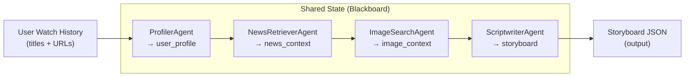
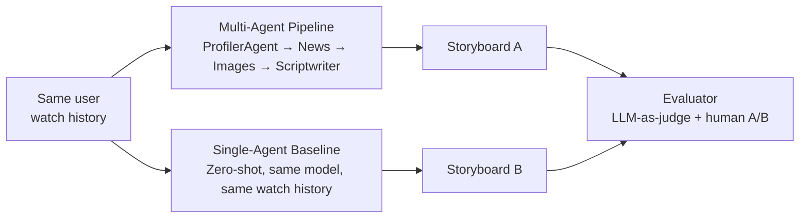

# COMP 4221 — Project Tracker
## Multi-Agent Storyboarding for Personalized Short-Video Generation

> [!IMPORTANT]
> **This document is the living record of the project.** Update it after every significant implementation step. It will feed directly into the final 6–8 page report (due Dec 4) and the live presentation (Nov 24–26).

---

## Research Question (Practical Test)

> *On **personalized short-video storyboarding**, our change — **a tool-augmented multi-agent brainstorming pipeline** — should improve **content creativity and alignment with niche user interests** relative to **a single-agent zero-shot generation baseline**, measured by **LLM-as-a-judge relevance/creativity scores and blind human preference testing** under a budget of **\$50 in API credits and local compute**.*

---

## Team & Ownership

| Component | Owner | Status |
|---|---|---|
| Data collection & public dataset filtering | Antoine | 🔲 TODO |
| Single-agent baseline | Antoine | 🔲 TODO |
| Multi-agent framework (core architecture) | Charles | 🟡 Skeleton done |
| Prompt engineering | Charles | 🔲 TODO |
| Real API integration (news, images) | Charles | 🔲 TODO |
| LLM-as-a-judge evaluator | Max | 🔲 TODO |
| Automated evaluation over dataset | Max | 🔲 TODO |
| Demo sketch renderer (TTS + images) | Max | 🔲 TODO |

---

## System Architecture

### Pipeline (MVP — Sequential)

> [!NOTE]
> **Why pipeline over debate loop for MVP?**  
> Sequential execution is cheaper (linear API cost), easier to debug, and sufficient to prove the core value of retrieval augmentation. A debate/critique loop (agents reviewing each other's outputs) will be explored as an **ablation** for the final report — isolating whether the improvement comes from *retrieval* or *multi-agent debate*.

### Agent Roles

| Agent | Input | Output | Model | Tools |
|---|---|---|---|---|
| **ProfilerAgent** | Watch history (titles + URLs) | `UserProfile` (interests, themes, style) | `deepseek-chat` | None (LLM-only) |
| **NewsRetrieverAgent** | `UserProfile` | `NewsContext` (headlines + summaries) | `deepseek-chat` | NewsAPI / Serper |
| **ImageSearchAgent** | `UserProfile` | `ImageContext` (image URLs) | `deepseek-chat` | Unsplash / Pexels |
| **ScriptwriterAgent** | Full `SharedState` | `Storyboard` (scenes, subtitles, audio) | `deepseek-chat` | None (LLM synthesis) |

### Controlled Comparison

---

## Data

### Public Dataset
- **Candidate:** KuaiRec or keyword-adapted MovieLens
- **Split:** train / dev / test (to be documented once selected)
- **Status:** 🔲 TODO (Antoine)

### Real User Histories
- YouTube Shorts watch histories from peers
- Format: `[{"title": "...", "url": "https://..."}]`
- **Status:** 🔲 TODO (Antoine)
- > [!CAUTION]
  > Must be anonymised before storage. Do not commit real user data to git.

---

## Models & API Configuration

| Parameter | Value | Rationale |
|---|---|---|
| LLM provider | DeepSeek API | OpenAI-compatible, very cheap |
| All agents model | `deepseek-chat` | Sufficient for pipeline tasks; budget-friendly |
| Baseline model | `deepseek-chat` | Same model = fair comparison |
| Temperature (profiler) | 0.4 | Low — factual extraction |
| Temperature (scriptwriter) | 0.8 | High — creative writing |
| News API | TBD (NewsAPI or Serper) | — |
| Image API | TBD (Unsplash or Pexels) | No vision model needed |

> [!TIP]
> For the report's **Reproducibility Statement**, log exact model name, API access date, and decoding params for every experiment run. These are saved in each `storyboard_*.json` output file.

---

## Prompts (Versioned)

| Agent | Prompt File | Version | Last Updated |
|---|---|---|---|
| ProfilerAgent | `prompts/profiler_system.txt` | v0.1 (inline) | 2026-10-30 |
| ScriptwriterAgent | `prompts/scriptwriter_system.txt` | v0.1 (inline) | 2026-10-30 |
| Baseline | `prompts/baseline_system.txt` | v0.1 (inline) | 2026-10-30 |
| LLM Judge | `prompts/judge_system.txt` | 🔲 TODO | — |

> [!NOTE]
> Prompts are currently inline in the agent files. Extract them to `prompts/` once finalised so they can be versioned independently (required for reproducibility package).

---

## Evaluation Plan

### Automated (LLM-as-a-Judge)
- **Metrics** (each 0–10):
  - **Relevance:** Does the storyboard match the user's inferred interests?
  - **Completeness:** Are all storyboard fields filled and coherent?
  - **Creativity:** Is the narrative original and diverse?
- **Judge model:** `deepseek-chat` (same family, different temperature)
- **Scale:** Run over public dataset subset

### Human Evaluation (Blind A/B)
- Real users see two storyboards (or rendered video sketches) — one from each system
- Blind: users do not know which is multi-agent vs. baseline
- Metric: preference vote + optional free-text reason
- **Status:** 🔲 TODO (Max)

---

## Milestone Checklist

### October 29 MVP (in progress)
- [x] Project skeleton created
- [x] SharedState blackboard defined
- [x] BaseAgent abstract class
- [x] ProfilerAgent stub
- [x] NewsRetrieverAgent stub
- [x] ImageSearchAgent stub
- [x] ScriptwriterAgent stub
- [x] Orchestrator pipeline
- [x] Single-agent baseline stub
- [x] Config and .env setup
- [ ] Real API integration (news)
- [ ] Real API integration (images)
- [ ] Full prompt engineering pass
- [ ] Run on example user history (end-to-end test)
- [ ] Baseline tested and producing output

### Final Report (Dec 4)
- [ ] Automated evaluation implemented and run
- [ ] Human evaluation conducted
- [ ] Results tables and figures
- [ ] Failure analysis (at least 1 informative failure case)
- [ ] Limitations and responsible use section
- [ ] Reproducibility package (README, requirements, prompts, eval code)
- [ ] Cost and compute statement
- [ ] Team contributions statement

---

## Cost & Compute Log

| Date | Component | Model | Tokens in/out | Cost USD | Notes |
|---|---|---|---|---|---|
| — | — | — | — | — | No runs yet |

**Budget remaining: \$50.00**

> [!WARNING]
> Track every API call cost here. Total budget is \$50. The multi-agent pipeline makes ~4 LLM calls per user (plus tool calls); the baseline makes 1.

---

## Design Decisions Log

| Date | Decision | Rationale | Alternatives considered |
|---|---|---|---|
| 2026-10-30 | Pipeline (sequential) over debate loop for MVP | Lower cost, simpler debug, sufficient for MVP | Debate loop (planned as ablation) |
| 2026-10-30 | Pure Python orchestration (no framework) | Full control, transparent for report, easier to understand | LangGraph, AutoGen, CrewAI |
| 2026-10-30 | DeepSeek API for all agents | OpenAI-compatible, very cheap, capable | GPT-4o (expensive), local models (slow) |
| 2026-10-30 | Shared state blackboard | Simple, natural top-to-bottom flow, easy to serialize | Message-passing between agents |
| 2026-10-30 | Image search by keyword only (no vision model) | Keeps cost low, avoids unnecessary complexity | CLIP-based image-text matching |

---

## Known Issues / TODOs

- [ ] `news_tool.py` and `image_tool.py` are mocked — need real API implementations
- [ ] JSON parsing in agents has no retry logic — add fallback for malformed LLM output
- [ ] Prompts are inline — move to `prompts/` directory and version them
- [ ] No token counting / cost tracking per run yet
- [ ] `ImageSearchAgent` has a model param but makes no LLM call — refactor or remove

---

## References

- Cheng et al. (2026). *Recommendation as Generation: Unifying Personalized Video Generation and Recommendation at Industrial Scale.*
- AutoGen: microsoft/autogen on GitHub
- ChatDev: Relevant multi-agent collaboration framework
- KuaiRec dataset: public short-video recommendation dataset
- DeepSeek API: platform.deepseek.com
