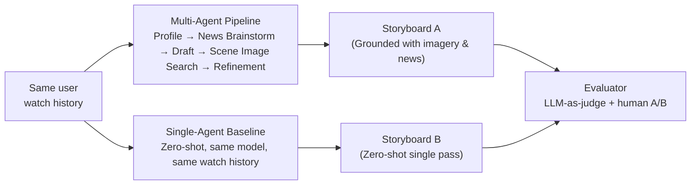

# COMP 4221 — Project Tracker
## Multi-Agent Storyboarding for Personalized Short-Video Generation

> [!IMPORTANT]
> **This document is the living record of the project.** Update it after every significant implementation step. It will feed directly into the final 6–8 page report (due Dec 4) and the live presentation (Nov 24–26).

---

## Research Question (Practical Test)

> *On **personalized short-video storyboarding**, our change — **a tool-augmented multi-agent brainstorming pipeline with visual grounding** — should improve **content creativity, visual coherence, and alignment with niche user interests** relative to **a single-agent zero-shot generation baseline**, measured by **LLM-as-a-judge relevance/creativity scores and blind human preference testing** under a budget of **\$50 in API credits and local compute**.*

---

## Team & Ownership

| Component | Owner | Status |
|---|---|---|
| Data collection & public dataset filtering | Antoine | 🔲 In progress (Peer collector live on GitHub Pages) |
| Single-agent baseline | Antoine | 🟢 Implemented, neutralized & tested on real user data |
| Multi-agent framework (core architecture) | Charles | 🟢 Writers' Room + Director + Targeted Retrieval complete & tested (v3.0) |
| Prompt engineering & refinement | Charles | 🟢 v3.0 active (Adaptive user style + neutral baseline) |
| Real API integration (news, images) | Charles | 🟢 100% Complete (NewsAPI + Unsplash + YouTube transcripts integrated & live) |
| LLM-as-a-judge evaluator | Max | 🔲 Next up (`evaluation/evaluator.py`) |
| Automated evaluation over dataset | Max | 🔲 TODO |
| Demo sketch renderer (TTS + images) | Max | 🔲 TODO |

---

## System Architecture

### Pipeline (Writers' Room & Director with Targeted Retrieval & Visual Grounding)

```mermaid
flowchart TD
    I["User Watch History\n(vid1, vid2, ... titles + URLs)"] --> P1["Phase 1A: Profiler Round 1\nMacro scan & active selection of 3-4 target videos"]
    P1 --> T1["Tool: youtube_transcript_api\nExtracts actual spoken dialogue & oEmbed channel metadata"]
    T1 --> P2["Phase 1B: Profiler Round 2\nSynthesizes fine-grained profile with concrete spoken insights"]
    P2 --> WR["Phase 2: WritersRoomAgent\nBrainstorms 3 distinct candidate pitches matching user style"]
    WR --> DIR["Phase 3: DirectorAgent (Showrunner)\nCritiques all 3 pitches, selects winner & issues production notes"]
    DIR --> N["Phase 4: NewsRetrieverAgent (Targeted Research)\nFormulates search queries specific to the winning pitch & director notes"]
    N --> S1["Phase 5: ScriptwriterAgent (Draft Pass)\nDrafts 60s storyboard executing winning pitch + director guidance"]
    S1 --> IMG["Phase 6: ImageSearchAgent\nAnalyzes draft scenes → photographic search → assigns img1, img2..."]
    IMG --> S2["Phase 7: ScriptwriterAgent (Refine Pass)\nGrounds scenes to visual assets using symbolic refs ('img1')"]
    S2 --> RES["Programmatic URL Resolution\nMaps 'image_ref' → validated 'image_url' (no hallucination)"]
    RES --> O["Storyboard JSON & Markdown\n(Pitches, Director Decision, Scenes, Subtitles, Narration, Image URLs)"]
```

> [!NOTE]
> **Why this Writers' Room architecture over a linear pipeline?**  
> 1. **User Style Adaptability:** Instead of forcing every user into an arbitrary documentary format, the Writers' Room proposes 3 distinct concepts matching their natural preferred style (witty humor, craft, pop culture, tech puzzle, or lore).
> 2. **Parallel Exploration (Exploration vs. Exploitation):** Parallel candidate pitches allow creative breadth before committing to production.
> 3. **Showrunner Deliberation:** The Director evaluates pitches against 3s hook potential, personal resonance, and visual feasibility.
> 4. **Targeted Information Retrieval:** The News/Fact Retriever searches for concrete evidence *tailored specifically to the winning pitch* and the Director's instructions.
> 5. **Symbolic Asset Grounding (`img1`, `img2`, ...):** Decoupling creative image selection from URL handling completely eliminates URL hallucination.

### Agent Roles

| Agent | Input | Output | Model | Tools |
|---|---|---|---|---|
| **ProfilerAgent** | Watch history (`vid1`, `vid2`, ...) | `UserProfile` (interests, themes, style, investigated_insights) | `deepseek-chat` | `youtube_transcript_api` + oEmbed |
| **WritersRoomAgent** | `UserProfile` + insights | `candidate_pitches` (3 diverse structured story pitches) | `deepseek-chat` | None (Creative synthesis) |
| **DirectorAgent** | `UserProfile` + `candidate_pitches` | `selected_pitch` + `director_critique` + `director_notes` | `deepseek-chat` | Editorial critique |
| **NewsRetrieverAgent** | `selected_pitch` + `director_notes` | `NewsContext` (targeted headlines + summaries) | `deepseek-chat` | NewsAPI / Serper / Web Search |
| **ScriptwriterAgent (Draft)** | `selected_pitch` + `director_notes` + `NewsContext` | Draft `Storyboard` (scenes, descriptions, audio) | `deepseek-chat` | None (LLM synthesis) |
| **ImageSearchAgent** | Draft `Storyboard` scenes | `ImageContext` (`img1`, `img2`, ... catalog) | `deepseek-chat` | Unsplash / Pexels (keyword search) |
| **ScriptwriterAgent (Refine)** | Draft `Storyboard` + `ImageContext` | Refined `Storyboard` (`image_ref: 'img1'`) | `deepseek-chat` | Programmatic URL resolver |

### Controlled Comparison

---

## Data

### Public Dataset
- **Candidate:** KuaiRec or keyword-adapted MovieLens
- **Split:** train / dev / test (to be documented once selected)
- **Status:** 🔲 TODO (Antoine)

### Real User Histories
- YouTube Shorts watch histories from peers
- Format: `[{"title": "...", "url": "https://..."}]`
- Represented in agent prompts cleanly as `[vid1] Title: "..." | URL: ...`
- **Collector Tool:** Client-side 1-click bookmarklet + tutorial web page (`tools/history_collector/index.html`) created and ready for distribution.
- **Ingestion Helper:** `src/tools/import_user_history.py` validates and saves participant files to `data/user_histories/<user>.json`.
- **Status:** Tooling complete; peer recruitment & data collection in progress (Antoine / Team).
- > [!CAUTION]
  > Must be anonymised before storage. Do not commit real user data to git.

---

## Models & API Configuration

| Parameter | Value | Rationale |
|---|---|---|
| LLM provider | DeepSeek API | OpenAI-compatible, very cheap |
| All agents model | `deepseek-chat` | Sufficient for pipeline tasks; budget-friendly |
| Baseline model | `deepseek-chat` | Same model = fair comparison |
| Temperature (profiler) | 0.4 | Low — factual extraction |
| Temperature (news brainstorm) | 0.7 | Medium — creative angle ideation |
| Temperature (script draft) | 0.75 | High — creative narrative generation |
| Temperature (script refine) | 0.6 | Controlled — alignment with visual assets |
| News API | TBD (NewsAPI or Serper) | — |
| Image API | TBD (Unsplash or Pexels) | No vision model needed (keyword-driven) |

> [!TIP]
> For the report's **Reproducibility Statement**, log exact model name, API access date, and decoding params for every experiment run. These are saved in each `storyboard_*.json` output file.

---

## Prompts (Versioned)

| Agent | Prompt File | Version | Last Updated |
|---|---|---|---|
| ProfilerAgent | `src/agents/profiler_agent.py` | v1.0 | 2026-10-30 |
| NewsRetrieverAgent | `src/agents/news_retriever_agent.py` | v1.0 (LLM brainstorm) | 2026-10-30 |
| ImageSearchAgent | `src/agents/image_search_agent.py` | v1.0 (Scene-guided visual queries) | 2026-10-30 |
| ScriptwriterAgent (Draft) | `src/agents/scriptwriter_agent.py` | v1.0 | 2026-10-30 |
| ScriptwriterAgent (Refine) | `src/agents/scriptwriter_agent.py` | v1.0 | 2026-10-30 |
| Baseline | `baseline/single_agent_baseline.py` | v1.0 | 2026-10-30 |
| LLM Judge | `evaluation/evaluator.py` | 🔲 TODO | — |

---

## Evaluation Plan

### Automated (LLM-as-a-Judge)
- **Metrics** (each 0–10):
  - **Relevance:** Does the storyboard match the user's inferred interests?
  - **Completeness:** Are all storyboard fields filled and coherent?
  - **Creativity:** Is the narrative original and diverse?
  - **Visual-Narrative Alignment:** How well do scene descriptions match the assigned image assets?
- **Judge model:** `deepseek-chat` (or `deepseek-reasoner`)
- **Scale:** Run over public dataset subset

### Human Evaluation (Blind A/B)
- Real users see two storyboards (or rendered video sketches) — one from each system
- Blind: users do not know which is multi-agent vs. baseline
- Metric: preference vote + optional free-text reason
- **Status:** 🔲 TODO (Max)

---

## Milestone Checklist

### October 29 MVP (Complete & Exceeded)
- [x] Project skeleton created
- [x] SharedState blackboard defined with markdown and JSON serialization
- [x] BaseAgent abstract class with unified `.run(state)` contract
- [x] ProfilerAgent with two-round deep profiling and spoken transcript tool integration
- [x] YouTube subtitle & metadata extractor (`src/tools/youtube_tool.py`) without API keys
- [x] Client-side YouTube Shorts history collector bookmarklet (`docs/collector.js` + `docs/index.html`) hosted on GitHub Pages
- [x] NewsRetrieverAgent with LLM query brainstorming focused on infotainment
- [x] ScriptwriterAgent with 2-pass Draft + Refine architecture & forensic storytelling
- [x] ImageSearchAgent with scene-guided queries & symbolic IDs (`img1`, `img2`, ...)
- [x] Programmatic image URL resolution (zero URL hallucination)
- [x] Orchestrator pipeline with 5-phase execution
- [x] Single-agent baseline aligned with identical I/O contract and tested
- [x] Config and .env setup (with automatic python-dotenv loading)
- [x] Unit tests passing (`python3 -m unittest discover tests` — 6 unit tests)
- [x] End-to-end pipeline run verified on real DeepSeek API and 94 real watch history items
- [x] Real API integration for news (NewsAPI.org live in `src/tools/news_tool.py`)
- [x] Real API integration for images (Unsplash API live in `src/tools/image_tool.py`)
- [x] Baseline tested and producing output on example and real user data

### Final Report (Dec 4)
- [ ] Automated evaluation implemented (`evaluation/evaluator.py`) and run
- [ ] Human evaluation conducted (Blind A/B test)
- [ ] Results tables and figures
- [ ] Failure analysis (at least 1 informative failure case)
- [ ] Limitations and responsible use section
- [ ] Reproducibility package (README, requirements, prompts, eval code)
- [ ] Cost and compute statement
- [ ] Team contributions statement

---

## Cost & Compute Log

| Date | Run ID | Component | Model | Status / Output | Notes |
|---|---|---|---|---|---|
| 2026-10-30 | `20261030_203738_4988344d` | Multi-Agent Pipeline (v0.1) | `deepseek-chat` | Success (6 scenes) | Initial linear pipeline smoke test |
| 2026-10-30 | `20261030_211708_49b2c57a` | Multi-Agent Pipeline (v1.0) | `deepseek-chat` | Success (7 scenes) | 5-phase feedback loop with scene image search & refinement |
| 2026-10-30 | `20261030_233028_8f65d1f9` | Multi-Agent Pipeline (v2.0) | `deepseek-chat` | Success (6 scenes) | Two-round profiling with spoken transcript extraction; forensic infotainment storyboard on Teletoon |
| 2026-10-30 | `baseline_20261030_234731_1896cb67` | Single-Agent Baseline (Neutral) | `deepseek-chat` | Success (6 scenes) | Scientifically neutral zero-shot baseline on same 94 videos; focused math paradox storyboard |
| 2026-10-31 | `20261031_014151_46ff9e3d` | Multi-Agent Pipeline (v3.0 - Writers' Room) | `deepseek-chat` | Success (5 scenes) | Writers' Room (3 candidate pitches) + Director deliberation + Targeted News Retrieval; Bic 4-color pen storyboard |
| 2026-10-31 | `20261031_015924_4a5dc1c6` | Multi-Agent Pipeline (v3.1 - Live APIs) | `deepseek-chat` | Success (6 scenes) | Fully live tool-augmented run: real NewsAPI articles + real Unsplash photographic CDN assets |
| 2026-10-31 | `20261031_124354_0ec406a8` | Multi-Agent Pipeline (v3.2 - Art Director Curation) | `deepseek-chat` | Success (6 scenes) | Two-phase Art Director image curation: concrete physical queries + candidate description re-ranking |

**Budget remaining: ~$49.58 / $50.00**

---

## Design Decisions Log

| Date | Decision | Rationale | Alternatives considered |
|---|---|---|---|
| 2026-10-31 | Two-Phase Art Director Image Curation (v3.2) | Eliminates unrepresentative stock photos. Prohibits cinematography jargon (macro, split screen) in queries; retrieves 4 candidates per scene and uses an Art Director LLM pass to select the most visually faithful candidate | Naive top-1 search with cinematic prompts (produced irrelevant photos like basketball courts for pens) |
| 2026-10-31 | Writers' Room + Director + Targeted News Retrieval (v3.0) | Adapts flexibly to any user style (witty humor, craft, puzzle, lore) without forcing a rigid format; parallel candidate pitches enable exploration before commitment; NewsRetriever targets the winning pitch with concrete evidence | Single rigid documentary prompt; blind retrieval before ideation |
| 2026-10-30 | Strictly Neutral, Competitive Baseline Prompting | Academic integrity: avoids creating a "strawman" baseline. Baseline is held to the identical high standards of thematic focus, narrative arc, and storytelling without biased jokes/skit prompts | Biased/comedic baseline prompts (disingenuous comparison) |
| 2026-10-30 | Two-Pass Feedback Loop (`Draft -> Image Search -> Refine`) | Ensures image queries match specific scenes rather than generic themes; lets scriptwriter ground descriptions in actual visual assets | Naive linear pipeline (`Image -> Script`) |
| 2026-10-30 | Two-Round Profiler with Spoken Transcript Extraction | Video titles are often clickbait or vague; Round 1 identifies candidate videos, tool fetches spoken dialogue via `youtube-transcript-api`, Round 2 discovers deep niche interests | Single-pass title-only profiling |
| 2026-10-30 | Infotainment & Forensic Storytelling over Cheesy AI Comedy | LLMs struggle with authentic humor, but excel at engaging narrative journalism and surprising real-world curiosities | Pure comedy/meme skits (results in cringe dialogue) |
| 2026-10-30 | LLM Query Brainstorming in NewsRetrieverAgent | Enables creative, niche cross-topic search angles rather than dumb keyword passthrough | Direct string passthrough of raw profile interests |
| 2026-10-30 | Symbolic Visual Identifiers (`img1`, `img2`...) + Code Resolution | Eliminates URL hallucination, shortens prompts, ensures robust data integrity | Trusting LLM to copy/paste long image URLs |
| 2026-10-30 | Pure Python orchestration (no heavy framework) | Full control, complete transparency for report, easy debugging | LangGraph, AutoGen, CrewAI |
| 2026-10-30 | DeepSeek API for all agents | OpenAI-compatible, extremely low cost, strong reasoning | GPT-4o, local quantized LLMs |
| 2026-10-30 | Image search by keyword only (no vision model) | Keeps compute/API cost low; vision model not required for asset retrieval | Multimodal vision models (expensive) |

---

## Known Issues / TODOs

- [ ] `news_tool.py` and `image_tool.py` are mock-ready — need real API keys (NewsAPI / Unsplash)
- [ ] JSON parsing in agents has simple cleanup fallback — can add retry loop for edge cases
- [ ] Move system prompts to dedicated `prompts/` text files for cleaner reproducibility archiving
- [ ] Implement token usage accounting in `state.py` to auto-calculate exact costs

---

## References

- Cheng et al. (2026). *Recommendation as Generation: Unifying Personalized Video Generation and Recommendation at Industrial Scale.*
- AutoGen: microsoft/autogen on GitHub
- ChatDev: Relevant multi-agent collaboration framework
- KuaiRec dataset: public short-video recommendation dataset
- DeepSeek API: platform.deepseek.com
